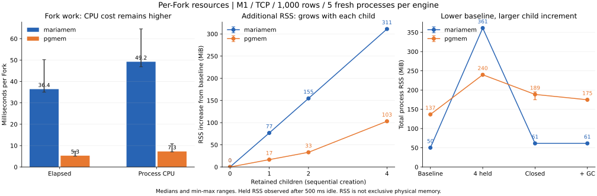

# Fork の追加コスト：CPU・Goヒープ・RSS

**この小さな fixture では、mariamem は子DBを作るCPU費用と保持RSSの増分が大きい。
一方、子なしの基準RSSと破棄後のRSSは pgmem より小さい。**
Goの割り当て量だけを見るとこの違いを取り逃がす。改善候補は、まず guest 起動時の仕事と
Goヒープ外で触るページの内訳。GC調整や「idle DBがCPUを使い続ける」仮説の優先度は低い。
ここでは最適化を実装せず、次の設計判断に使う観測を得た。



## 固定条件と解釈

Apple M1 / 16 GiB / macOS27.2 / Go1.27.3 / CGO0 / GOMAXPROCS8。
mariamem v0.6.0 と pgmem v1.18.2、両方とも通常のTCPドライバ経路。
[typed source/tag pins](forkresources/source-pins.json)を `git_identity.py` で検証し、
clean checkoutからビルドした。実際のserverはMariaDB12.3.3 / PostgreSQL18.3。
[inputs](forkresources/results/inputs.json)に exact harness source、binary hash、依存版、host、計測計画を保存。

同じschema `fork_probe(id INTEGER PRIMARY KEY, v INTEGER NOT NULL)`、1,000整数行を用意。
COUNT1000/SUM500500を確認し、Snapshot後にsourceを閉じる。
子を**順に**作り0→1→2→4個保持する。これはP4の同時実行性能試験ではない。
各子でTCP接続・SELECT1・初期データ確認後に接続を閉じる。1/2/4子で500ms待機も観測する。
4子保持後に明示GCを行い、各子の独立した更新/結果を検証。全子Close→GC→FreeOSMemoryを別観測とする。
最後にもう1子でbaselineの不変性を確認し、Snapshotも閉じる。この確認用Forkは集計対象外。

各製品5 fresh processes、別warmup1回。製品順を交互にし、外れ値は除外しない。
Forkの表は各processの4子中央値を1観測とし、5観測の中央値/範囲。
20子を独立した20反復とは扱わない。保持量の差分は各process内のbaseline GC後から計算する。
**保持数と経過時間は連動する**ため、回帰係数を普遍的な「1子のサイズ」とはしない。
先行P1/P4/P8は別cohort。今回のresource-observed時間を、それらの無観測時間に混ぜない。

CPUはprocess全体のuser+system時間（`getrusage`）、Goメモリは`ReadMemStats`。
CPU時間は複数threadの合計なので経過時間を超え得る。
RSSは子processがcheckpointで待つ間、外側のcontrollerが`ps`で取得。
**RSSはexclusive/PSS/physical footprintではなく、共有ページの扱いも含むprocess観測値**。
最大RSSはprocessのhigh-water markであり、子別ピークや解放量には使わない。
Goヒープ外のmappingはGo割り当て量に含まれない。仮想予約サイズもRSSと区別する。

## 1. Fork のCPU費用は実際に大きい

| 指標 | mariamem | pgmem |
| --- | ---: | ---: |
| Fork 経過時間中央値 | 36.41ms | 5.30ms |
| process CPU時間中央値 | **49.23ms** | **7.27ms** |
| CPU時間の5観測の範囲 | 46.87–64.58ms | 7.09–10.86ms |
| Go割り当て総量/Fork | **2.43MiB** | **2.28MiB** |

CPUの違いは単なるwall-clock上の待ちでは説明できない。一方、Go割り当ての量には約7倍の差はない。
これは「Goオブジェクトを大量に作るから遅い」より、guest実行、初期化、mappingのページフォールト、
コピー等を次に分離する理由になる。どの関数がCPUを消費したかは未計測で、特定原因の確定ではない。

計測器のnoopはGo割り当て0、CPU中央値mariamem0.016ms / pgmem0.010ms。
計測処理の影響はゼロではないが、今回の数十ms差と同程度ではない。

## 2. Goヒープの大きさとRSSの大きさは逆転する

接続を閉じ、各保持点で500ms待った後。単位MiB、各5processの中央値。

| 保持状態 | mariamem RSS総量 | baselineからの増分 | pgmem RSS総量 | baselineからの増分 |
| --- | ---: | ---: | ---: | ---: |
| 0子、baseline GC後 | 50.20 | 0 | 136.69 | 0 |
| 1子 | 127.06 | +76.78 | 153.31 | +16.62 |
| 2子 | 204.77 | +154.64 | 169.88 | +33.14 |
| 4子 | **361.22** | **+311.09** | **239.77** | **+103.14** |

総量の中央値とprocess内差分の中央値は別々に計算するため、引き算が完全には一致しない。
4子のRSS増分範囲はmariamem310.83–311.33MiB / pgmem102.88–103.98MiB。
このfixtureでは、mariamemは1子まで総量が小さく、2子以降で逆転する。
0子時点にはsource起動・seed・Snapshot・source Closeの履歴が含まれ、snapshot object単体のサイズではない。

4子保持中にGCを行ったGoヒープ増分は、mariamem **9.83MiB** / pgmem **70.22MiB**。
RSS増分はその時点でも311.27MiB /103.14MiB。mariamemのRSS増加をGoヒープだけでは説明できない。
単純な差をmappingの正確な物理サイズと断定はしないが、guestの線形メモリ等を調べる価値がある。

pgmemはFork直後より待機後にGo割り当てが増える。500ms区間の割り当て量は1/2子時約16MiB、
4子時約32MiB。このため4子直後のRSS205.59MiBを最終保持量として採用しなかった。
背景処理の種類は未同定であり、pgmemにも無条件に小さい/一定という主張はしない。

## 3. 破棄は機能し、idle CPUも大きくない

| 状態・RSS中央値(MiB) | mariamem | pgmem |
| --- | ---: | ---: |
| 4子保持・500ms後 | 361.22 | 239.77 |
| 更新検証後、4子Close直後 | **61.41** | 188.67 |
| さらにGC後 | 61.41 | 174.78 |
| さらにFreeOSMemory後 | 61.41 | 174.80 |

mariamemのRSSはGC前に大きく下がる。GoヒープはClose直後14.78MiB→GC後3.34MiB。
Snapshotを閉じた後の強制回収では0.36MiB、RSS61.41MiBだった。
基準RSSへ完全には戻らないが、これだけでleakとは判定しない。pgmemも同様に、残存量をleakと呼ばない。
長時間idle後、繰り返し再利用での蓄積、OSの物理footprintは今回未測定。
明示GC/FreeOSMemoryは診断であり、利用者への推奨手順やproduct動作の変更ではない。

500ms idle区間のCPUは1/2/4子のprocess内中央値→5process中央値で、mariamem0.414ms /
pgmem4.319ms。今回の条件では、mariamemの常時busy loopを改善の第一候補にする根拠はない。

## 改善への示唆と次の停止点

**推奨：guest初期化のCPU内訳と、子が触るmemory領域を一度だけ対応付ける。**
今回の結果は「子を増やす費用を減らす」を調べる根拠であり、GCチューニング、TCP廃止、全体改修の承認ではない。
次の調査を行うなら、初期化/restore/内部buffer等の支配項を特定し、変更候補と意味論上の制約を出して止める。

source上にも比較する価値のある違いがある：

- mariamemは各instanceでanonymous mappingを作り、guestを開始する。
  [memory backing](https://github.com/masahitojp/mariamem/blob/b3b3b46a8807482ad3f96725af86e031fe369b01/internal/generatedgo/memory_backing_unix.go)、
  [runtime startup](https://github.com/masahitojp/mariamem/blob/b3b3b46a8807482ad3f96725af86e031fe369b01/internal/generatedgo/runtime_instance.go)。
  2GiB仮想予約や256MiB初期RW範囲を、そのまま物理消費と解釈しない。
- pgmemのAOT factoryは初期data segmentのshared imageを作り、各instanceへcopy-on-writeでmapする。
  constructorsはinstanceごとに実行し、環境を共有しない。
  [exact source](https://github.com/shibukawa/pgmem/blob/a61005d37d01e6671f814fe8ca828222e8147df4/internal/aot/aot.go)。

これは共有可能な初期領域を調べる候補だが、今回の差がその仕組みだけで消える証拠はない。
MariaDB/PostgreSQLの内部buffer・起動処理・DB lifecycle自体も異なる。
本計測にはCPU profileやmapping別のprivate/shared resident内訳がなく、節約可能量は未確定。

## 検証・保存・再現

正例2、破壊seedを検出する負例2のpilotは成功し、接続/DB/Snapshot/tempの後始末を確認。
本計測は10process（40 retained children＋10 baseline検証children）、別warmup2process。
各processの全17観測点、全phase、外部RSS値を[compact observations](forkresources/results/observations.json)に保持。
[JSON](forkresources/results/summary.json) / [CSV](forkresources/results/summary.csv) /
[checksums](forkresources/results/SHA256SUMS.json)を保存。

[Raw evidence](https://github.com/masahitojp/mariamem/tree/633a299da044e21cdb25aaf76249466a2e03e0a6/benchmarks/forkresources/raw)
は別refに固定。[archive](forkresources/results/archive.json)がmanifest digestを固定する。
owned pathのみ正規化し、original/published hashを保存。rawと探索履歴をmainへmergeしない。
採用するならcompact final treeを選択/squashし、採用判断は別。

```sh
python3 benchmarks/forkresources/analyze.py --results benchmarks/forkresources/results --check
PYTHONDONTWRITEBYTECODE=1 python3 benchmarks/forkresources/test_analysis.py
```

build/temp/rawなしの読み取り専用checkが全反復からJSON/CSVを再計算する。
4 focused testsはread-only性、checksumを再計算した誤ったsummary、欠落反復、CPU差分の不整合を検出。
collectorのnull phase list処理のみ計測後に修正し、計測バイナリは変えていない。
`--collect <pinned raw export> --results <new directory>`で同じ数値集合を再抽出できる。

再計測は[plan](forkresources/plan.json)の予算内でworkspaceをprepareし、`temp/product`・`temp/pgmem`へ
typed pinどおりcheckoutする。harnessをcommitし、`run.py`を`evidence/run.py`へコピーして
`--phase build`→`pilot`→`matrix`をdisk guard経由で実行する。
取得/ビルドは測定に含めず、制御したbenchmark processだけを順次実行する。
active75分、tooling20分、heavy CI0回、disk12GiB/free reserve16GiB。
終了後にcompact evidenceを保全し、owned checkout/build/cacheを破棄する。

これは1ホストの改善仮説の調査であり、v0.7資源受入、main採用、releaseにはしない。
product/API/guest/generated/releaseの差分はない。
