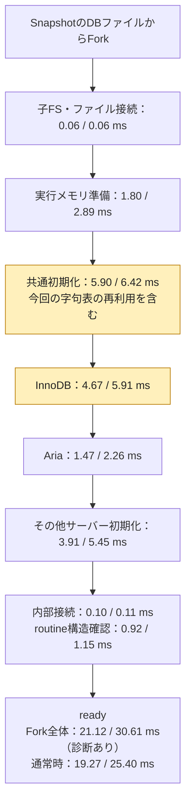

# Prepared lexer C candidate and current Fork attribution

## Conclusion

After the prepared lexer-map Go surrogate, common initialization remains the largest P1 block (p50 5.90ms), followed by InnoDB (4.67ms). At P4, common initialization (6.42ms), InnoDB (5.91ms) and other server initialization (5.45ms) are close. Memory preparation is 1.80/2.89ms. InnoDB existing-file open/recovery and buffer-pool preparation account for 1.77/1.29ms atP1 and2.07/1.70ms atP4; transaction preparation is0.13/0.15ms. These are **same-cohort diagnostic elapsed intervals, not CPU self-time**.

The diagnostic observer increases Fork p50 by9.5–20.5%. Ordinary prepared Fork p50 is19.27/25.40ms (P1/P4), versus traced21.12/30.61ms. Do not assign the traced stage milliseconds to the ordinary API total, subtract historical cohorts, or add component medians to produce a total.

Recommendation: validate this bounded C-source candidate next, before choosing another optimization. Common initialization still offers a reason to inspect a concrete remaining producer later; this report does not authorize a new hypothesis or set an expected saving for the whole common block. No product adoption, main integration, Qualification or release is claimed.

## Identity and finite campaign

- Product baseline source_commit `3d8b2201c1f36fa5b7264e0450104055f3822272`; measured harness source_commit `950b4b40` (full commit in inputs.json).
- Existing guest SHA256 `6d7442204d39bc28eb4b34401874b84b4d3f517c2bb698ba7f3a465027c36cbe`. The measured binary uses a Go overlay; **it is not a rebuild of the new C patch**.
- AppleM1/16GiB, Go1.27.3,CGO0,GOMAXPROCS8,GOGC100,Pipe,1000 seed rows,48 independent children.
- 37 final processes:24 primary (1152 children),8 warmups,2 SQL controls,2 expected-negative seed controls,1 separate input inventory. Three alternating pairs per P1/P4 × observer off/on.576 primary diagnostic children. Every successful child checks pristine data, commits an UPDATE, retires connections and closes. Mapping/reserved/RW/release counters return to zero.
- Desktop host, not an isolated performance runner. All children and tails retained. P4 whole-suite timings contain long COUNT/SUM tails; they are not silently reclassified as UPDATE/UNDO waits.

## Current phase map

Values are pooled per-child p50/p95 over144 children per traced arm/cell. All stage intervals below are diagnostic-on; their sums of medians are not additive.

| Phase after prepared maps | P1 p50 ms | P1 p95 ms | P4 p50 ms | P4 p95 ms |
|---|---:|---:|---:|---:|
| 実行メモリ準備 | 1.80 | 2.01 | 2.89 | 5.88 |
| 共通初期化（字句表を含む） | 5.90 | 9.79 | 6.42 | 11.97 |
| InnoDB | 4.67 | 4.95 | 5.91 | 9.29 |
| Aria | 1.47 | 1.79 | 2.26 | 5.54 |
| その他のサーバー初期化 | 3.91 | 4.32 | 5.45 | 8.94 |
| routine構造確認 | 0.92 | 1.36 | 1.15 | 3.46 |
| 内部接続 | 0.10 | 0.30 | 0.11 | 0.54 |
| 子FS・ファイル接続 | 0.06 | 0.06 | 0.06 | 0.33 |
| startup外のhost処理 | 1.12 | 1.72 | 1.70 | 3.41 |
| 実行開始からguest開始等の残り | 0.85 | 1.00 | 1.31 | 3.90 |
| その他guest処理 | 0.04 | 0.05 | 0.04 | 0.08 |
| ready後のhost処理 | 0.14 | 0.35 | 0.24 | 1.48 |

Labels are P1/P4, rounded p50. The graph groups some initialization work for readability; it does not assert Aria always executes after InnoDB. Host residuals and other guest work remain in the table. `children.csv` contains exact additive per-child accounting; representative children in summary.json are actual individual traces nearest each cell's median, not synthetic sums of medians. No traced server_init/common/InnoDB interval exceeds100ms in the primary cohort. Across576 primary UNDO traces,147840 purge scopes completed with zero aborts, zero query-rseg waits, three background page waits and zero matched relay chains. Two COUNT/SUM >100ms observations remain unassigned to this mechanism; no UPDATE >100ms occurred in the diagnostic cohort.

## Ordinary API observations (observer off)

| Arm | P1 Fork p50 | P4 Fork p50 | P1 suite median | P4 suite median |
|---|---:|---:|---:|---:|
| Original generation |20.78ms|28.48ms|1265.17ms|510.10ms|
| Prepared Go surrogate |19.27ms|25.40ms|1177.14ms|463.04ms|

This is a separate three-pair cohort from the prior five-pair prototype. Do not relabel the prior paired effect or its exact totals as this run.

## Candidate correctness and remaining gate

The C patch is isolated in `guest/experimental.patch`. Only the pre-XML compiled registration callsite uses a new wrapper. It binds638 unique compiled charset IDs to28 `static const` 512-byte pairs (14336bytes); CHARSET_INFO, engine and allocator state remain per guest. It has no guest-address allowlist and no host pointer stored in guest memory. Dynamic XML/copy callsites and unknown/noncompiled IDs retain the original producer. Known compiled IDs no longer allocate a lexer map; eliminating that allocation also eliminates its OOM failure point. This is an intentional bounded resource semantic difference, not an ignored error. Static data still belongs to each guest memory image; this is not cross-guest page sharing.

The original pinned C `is_multi_byte_ident`/`init_state_maps` algorithm was compiled by native clang and replayed with actual guest m_ctype257-byte inputs and all256 one-byte charlen results for every638 descriptor. Every512-byte output agrees. Native component controls cover static pointer assignment, separate metadata objects, noncompiled/unknown fallback, allocation failure, force-original/verify switches and a table corruption that must fail. This is an independent C-algorithm replay with captured handler results, **not a native full MariaDB build or native SQL reference**.

The next CI acquires one UNQUALIFIED C guest build, a native MariaDB12.3.3 SQL reference and both-OS raw Go translations. Existing runtime installer guards deliberately pin the adopted old guest, exact function bodies and tables (including thread lifetime and CRC). The new translation must be inspected and exact bindings re-established before installing it. CI stops at PASS_INPUT_AND_TRANSLATION_ONLY; it must not claim actual guest or SQL differential acceptance. The prepared actual-guest test and SQL script are not yet executed against the new C guest. It does not establish independent two-C-build reproducibility, actual dynamic XML loading, a C-candidate performance gain, main adoption or release eligibility. Those remain explicit later gates.

## Preflight findings and failures

The final cohort uses one binary; two successful host binaries were built across preflight and the corrected source. Two initial build attempts stopped at sandbox DNS and a nested Go-module import; both logs are retained. One address-bound diagnostic warmup completed SQL/cleanup but only226/638 prepared lookups per initialization succeeded; diagnostics changed early allocator addresses. The preflight stopped before any primary run. Its eight recorded preflight processes plus the failing warmup/report and traces are preserved. The corrected surrogate uses compiled IDs at the same compiled-only callsite, and all final prepared initializations assert638 hits and zero fallback (except the deliberate verify fallback control). A focused relocation unit test covers this finding. Final measured source950b4b40 and both prior sources remain distinct. This does not invalidate the prior off-observer result, whose counters asserted638 hits, but exposes the prototype address binding as unsuitable for a real candidate.

## Replay / retention

`results/analyze.py --check` checks the complete finite matrix, trace presence/order, event/plugin nesting, zero dropped initialization records, SQL/cleanup and exact per-child phase accounting. It reads compact `observations.json`; `stage_analysis.py` is the pinned decoder. `results/undo_analysis.py` replays the separate compact UNDO archive when supplied (see archive-digests.json). Generated caches, binary, temporary source and worktree are deleted after preservation.

For original C replay: fetch the two source files with `fetch_source.py --output <owned-work>/temp/pristine`, then `c_source.py --check --work-dir <owned-work>`. Original upstream code/headers are hash checked. This writes owned work/evidence, never rewrites the committed candidate under --check.

The report/checksums preserve the exact measured source; later candidate C/test/workflow files are new, unmeasured inputs. Existing product runtime/guest canonical inputs remain identical to adopted baseline. The new C patch is explicitly experimental.
