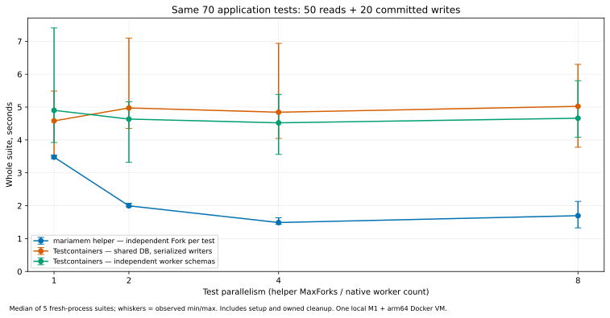
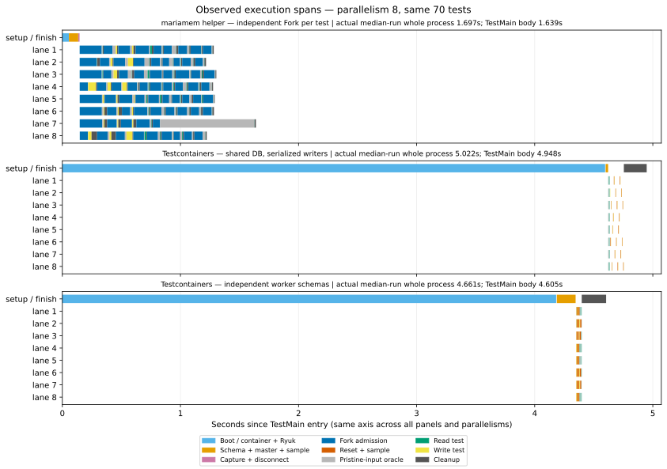

# 同じ70テストを並列実行する：mariamem Go helper と Testcontainers

**今回の全体所要時間は mariamem helper が短く、並列度4が最短でした。**
1→4並列で中央値3.48→1.49秒。8並列は1.70秒で、増やし続ければ速くなる結果ではありません。
この用途の説明には、下の全体グラフと実測タイムラインを使うことを勧めます。

主な反対材料もあります。**DB準備後のテスト区間は Testcontainers 側が短い**ため、
長寿命のnative serverや別のsuiteサイズにも同じ優位性があるとは言えません。
今回の利点は軽いsuite準備と、独立したForkの費用を並列で縮められることです。
SQLエンジン自体の速さや、すべての構成での優位性を示す比較ではありません。

## 全体所要時間

秒、各5回の中央値（最小–最大）。毎回新しいテストプロセスを起動し、DB起動・準備・
70ケース・所有するDB/pool/containerの終了・プロセス終了までを測定。
ダウンロードとコンパイルは除外し、各セルの別warmup1回も除外しています。

| 並列度 | mariamem helper：全テスト独立Fork | Testcontainers：共有DB | Testcontainers：workerごとのDB/schema |
| ---: | ---: | ---: | ---: |
| 1 | **3.478** (3.433–3.539) | 4.580 (3.512–5.488) | 4.901 (3.922–7.406) |
| 2 | **1.997** (1.969–2.075) | 4.974 (4.350–7.099) | 4.635 (3.319–5.160) |
| 4 | **1.488** (1.433–1.633) | 4.844 (4.046–6.939) | 4.521 (3.562–5.384) |
| 8 | **1.697** (1.326–2.132) | 5.022 (3.778–6.299) | 4.661 (4.085–5.802) |

エラーバーは観測範囲で、信頼区間ではありません。中央値同士の比では、並列度4の
helperはworker schema構成の約3.04倍短い所要時間でした。これはこの70ケース・この
単一環境での比であり、個別queryのspeedupや一般的な性能保証ではありません。

## 実測タイムライン

各方式で**全体時間が中央値だった実際の1実行**を選びました。合成した中央値の棒ではありません。
青系は起動/Fork、橙系はschema/seed/reset、灰色は入力検証とcleanup、緑は読み取り、黄は書き込みです。
laneはテストのadmission枠であり、固定のschema番号やOS thread番号ではありません。

時間軸はTestMain開始をゼロとし、3方式・すべての並列度で同じ縮尺です。
全体時間にはこの区間の前後のGoプロセス処理も含み、棒の長さの和は並列wall timeではありません。
空白には非計装のオーケストレーション等も含まれます。
図の各処理時間を足して、別の全体時間を作っていません。

[並列度1](modelcase/results/plots/timeline-p1.svg) /
[2](modelcase/results/plots/timeline-p2.svg) /
[4](modelcase/results/plots/timeline-p4.svg) /
[8](modelcase/results/plots/timeline-p8.svg)。
全図をまとめた[単独HTML](modelcase/results/comparison.html)はダウンロードしてブラウザで開けます。

### どこで差がついたか

- 並列度4の代表実行では、helperのboot約54ms、schema/seed約82ms、capture/disconnect約12ms。
  Fork・初期状態検証・SQL・子のcleanupの区間は約1.28秒でした。
- 同じ並列度のworker schema構成は、container/Ryuk boot約4.12秒、全workerのschema/seed約81ms。
  準備後のケース区間は約77ms、owner cleanup約194msでした。
- 共有DBでも代表実行のbootは約4.39秒、ケース区間約150ms。
  書き込みは直列ですが、このfixtureの全体時間はresetより**container起動が支配的**です。
- helperの8並列は4並列より中央値が悪く、範囲も広がりました。trace上は実際に8ケースが
  重なっていますが、CPU・memory・scheduler等の原因を資源観測で分離してはいません。
  「このmachineでは4が最短」と「helperの一般的な最適並列度」は別です。

上の内訳は各セルの中央値実行に対応する値です。各phaseそれぞれの中央値ではありません。
DB準備後のnative側が短いことは、serverを長く使い回す場合の重要な反対材料です。
server reuseやsuite規模を変えた交差点は未計測で、ここから外挿しません。

## 比較条件と分離境界

pgmemの[model-case計測](https://shibukawa.github.io/pgmem/benchmarks/)に着想を得た、
独自のMariaDB用shopデータ層です。pgmemのSQL・trigger/viewや公表値の再現ではありません。
読み取り5シナリオ×10件、書き込み5シナリオ×4件。注文一覧/詳細、売上/商品照会、
注文作成/取消/発送、ユーザー削除、値引きを、**同じcase関数・SQL・seed・期待値**で実行します。

5つのInnoDB表、20categories・500products・1000users・40sample orders。
各ケース直前にCOUNTとprice/stockのSUMで初期状態を確認し、処理後は行の値と件数を検証。
書き込みcaseは実際にcommitし、外側のtransaction rollbackで隔離を代用しません。
この追加の初期状態oracleも全方式で測定時間に含まれるため、pgmemのsuiteとSQL量は異なります。

| 方式 | 実行/再利用/分離 |
| --- | --- |
| mariamem helper | 公開済み`mariamemtest.New`で準備済みSnapshotを1回作成。**読み取りも含む全70件**が`fixture.DB(t)`で独立Fork。`MaxForks=P`、`-test.parallel=P`、各子のconsumer poolは最大1接続 |
| Testcontainers shared | suiteごとに1container/1DB。50readは並列、その終了後に20writeを直列実行。前のwriteで変化したデータをresetして次へ。共有poolの上限P |
| Testcontainers workers | suiteごとに1containerとP個の独立DB/schema。各workerを初期化し、最大Pケースを並列実行。前のcaseがwriteだったworkerだけreset。poolはworkerごとに1接続、別途admin pool1接続 |

MariaDBではdatabase/schemaを同義で使っています。nativeのworker構成は別server/containerではなく、
global/server状態を共有します。Forkのserver分離と同じ保証ではありませんが、このcase群が
使うschema/dataの分離はoracleで確認しています。workerをread後にも毎回resetして不必要な費用を
課してはいません。helper側には読み取りだけbaselineを共有する最適化を追加していません。

## 固定した実行環境・identity

- mariamem v0.6.0: source_commit `b3b3b46a8807482ad3f96725af86e031fe369b01`、
  tag_object_sha `b57183b08d48884840111e8b53daa500734337f0`。
  cleanな独立checkoutを`git_identity.py`で確認してからbuild。
- harness source_commit `f7c1445444f0f153e10c7c0394c01e4990b249c4`。
  実runtime sourceとharnessのSHAは別です。binary・app SQL/fixture・module lock・driver・
  orchestration/analysisのhashと実際のGo build infoは[inputs.json](modelcase/results/inputs.json)に保存。
- Go1.26.10、CGO_ENABLED=0、GOMAXPROCS=8。mysql driver1.9.3、Testcontainers Go0.40.0。
  同じtest binaryから全方式を実行。temp moduleのreplaceは上記のclean product checkoutへ固定。
- Apple M1/16GiB、macOS27.2。native MariaDBも同じ12.3.3、Docker Desktop29.9.2 engine、
  Linux arm64 VM、8CPU、8,319,770,624bytes RAM、overlay2。amd64 emulationは使用せず。
- native image: `mariadb@sha256:805c8e104bd563d5bfa24fadd3f31cd419ea859cb5277f32b5dbf2db714f9ed1`。
  実image ID、arm64、mariadbdの12.3.3表示と、各suiteの`SELECT VERSION()`を確認。
  Ryuk0.13.0も取得済みimageを使用し、各native test processからの起動はtimed interval内。
- 設定は性能を揃えるために変更していません。InnoDB poolはembedded16MiB/native128MiB、
  max_connectionsは10/151、flush_log_at_trx_commitは両方1、sync_binlogは両方0。
  表のutf8mb4/collationは明示。nativeは通常のpassword認証とDocker storage、embeddedは
  memory filesystem/skip-grantsであり、同じengine内部の統制A/Bではありません。
- `docker ps`のvisible一覧は前後0件、daemon Infoのrunning countは前後3件で一致しませんでした。
  原因は未調査で、背景サービス不在やhost負荷の完全な統制は主張しません。
  無関係なcontainer停止やVM再起動は行っていません。

## 実行と検証

並列度1の3方式pilotが成功してから本計測。各並列度で別warmup1回、5回の本計測を行い、
方式の順序を回ごとにrotateしました。並列度の順序は1→2→4→8で、thermal/background変化を
完全に無作為化したものではありません。

本計測60suite/4200cases、別warmup12suite/840casesが完了。
毎suiteの70case名/成功結果/非負span/slot非重複/同時実行上限を事後検証し、
実際のpeak case数はP=1/2/4/8でした。共有DBはwriteと他のcaseが重ならないことも検証。
壊したseedのnegative controlは`pristine input differs`で期待どおり失敗し、cleanup成功を確認しました。

全native suiteで自身が作ったDB container IDの不存在を確認し、最後のvisible一覧にも
DB/Ryukは残っていませんでした。SDK0.40.0のTerminateはRemoveVolumes=trueです。
tmp scratchは空。forced killや一般的なリーク不在の保証ではありません。

初期の2件は本計測へ混ぜず保存しています。最初はmetadata用`SHOW VARIABLES LIKE ?`の
構文エラーで準備中断、次はDockerの小文字`no such object`をラッパーが誤判定しました。
固定変数名の`SELECT @@...`とcase-insensitiveな不存在判定へ修正し、app SQLと期待値は変更していません。
slow sampleを削除したり、元の失敗をPASSへ貼り替えたりしていません。

単一host、各5回、1つの小規模アプリfixtureという限定結果です。memory/CPU比較、
100MiB、Ubuntu、cold acquisition、全SQL互換性、resource-model評価は対象外。
性能のPASS閾値や新しいrelease gateは導入していません。

## Evidenceと再現

[summary.csv](modelcase/results/summary.csv) /
[全raw suite](modelcase/results/matrix/) /
[trace検証](modelcase/results/trace-validation.json) /
[pilot](modelcase/results/pilot-result.json) /
[checksums](modelcase/results/SHA256SUMS.json)。
SDKログのhost home prefixのみredactし、[元hash](modelcase/results/redactions.json)と保存後hashを別記。

[run.py](modelcase/results/run.py)をprepared workspaceの`evidence/`に置き、既存disk guardで
`--phase pilot`、成功後`--phase matrix`を実行。その後[analyze.py](modelcase/results/analyze.py)で
trace検証・集計・MatplotlibのSVG/PNGと単独HTMLを再生成します。
既定の予算はactive2時間/tooling30分、workspace16GiB/free reserve16GiB、heavy CI0回。
完了後は結果とsource/hashを残し、compile cache・binary・clone・worktreeをcleanupします。
本レポートは計測の成果物であり、runtime変更や性能修正の採用承認ではありません。
