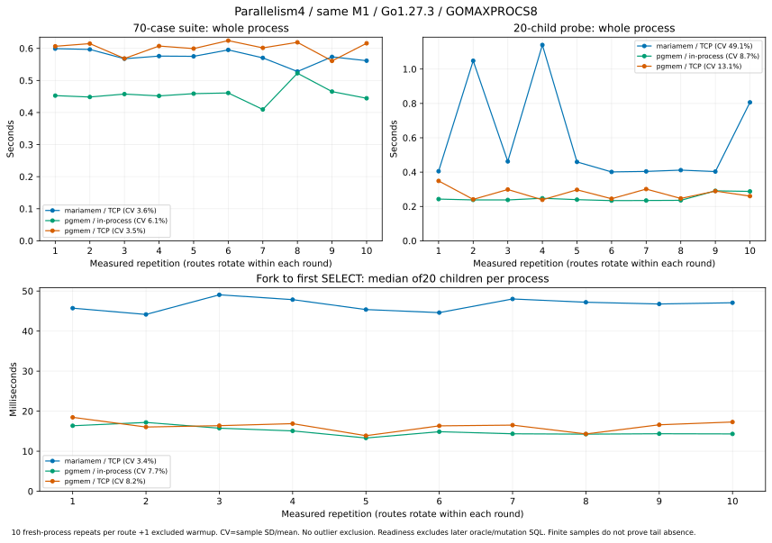

# 並列度4を10回：pgmemもブレるか

**pgmemにも振れがあります。今回の70件ではmariamemとpgmem/TCPの振れは近く、
pgmemのプロセス内接続は最速でしたが、変動係数はやや大きく出ました。**
「pgmemは常に一定」「mariamemは常に大きくブレる」という読みは、この10回とは合いません。
一方、小プローブ全体ではmariamemの大きな振れが残っています。指標を分けて見るのが結論です。



同じM1/16GiB/macOS27.2、Go1.27.3、GOMAXPROCS8、test parallelism4。
各経路10 fresh processes＋別warmup1回で、実行順をroundごとにrotate。
ビルド・取得は除外し、外れ値の削除はしていません。
このP4 cohortを[前のP1/P8結果](pgmem-same-host.md)へ混ぜたり、過去receiptを貼り替えたりしていません。

## 70件の全体時間

ms。SDは標本標準偏差、CVはSD÷平均×100。中央値に対する割合ではありません。
CVが小さいほど今回の10回の相対的な振れが小さい、という指標です。

| 経路 | 中央値 | 最小–最大 | SD | CV |
| --- | ---: | ---: | ---: | ---: |
| mariamem / TCP | **574.4** | 527.9–599.2 | 20.9 | **3.6%** |
| pgmem / プロセス内接続 | **455.1** | 409.6–522.5 | 27.7 | **6.1%** |
| pgmem / TCP | **607.0** | 561.0–624.3 | 21.1 | **3.5%** |

mariamem/TCPとpgmem/TCPのSDは約21msで近い値です。このcohortではmariamem/TCPが
中央値で短く、各対でも9/10対で短くなりました。pgmemのプロセス内接続は全10対で
mariamemより短い値です。エンジン間ではアプリSQL/検証が異なるため一般的な速度比にはしません。

全10回の実行順の値（ms、小数1桁、warmupを含まない）：

| 経路 | 1→10回目 |
| --- | --- |
| mariamem/TCP | 599.2, 596.8, 567.8, 576.0, 575.3, 595.3, 570.5, 527.9, 573.6, 561.6 |
| pgmem/プロセス内 | 452.7, 448.4, 457.6, 451.8, 458.9, 461.0, 409.6, 522.5, 465.3, 444.5 |
| pgmem/TCP | 606.6, 614.9, 568.5, 607.4, 599.4, 624.3, 601.7, 618.9, 561.0, 615.9 |

今回は前の8並列のようなmariamemの1.3秒級の70件実行は出ませんでした。
ただしP4/P8は同時対比較ではなく、回数も異なります。P4が普遍的な最適値と決まったわけではなく、
10回でまれなtailやengine単体の安定性を証明していません。通常のOS活動も残ります。

## 小プローブでは区間によって見え方が変わる

前と同じ1,000行・20個の独立した子DBで、worker上限4を固定。
root準備から後始末/終了までのprocess全体と、子ごとのFork→物理接続→SELECT1成功を分けます。
readiness後にはCOUNT/SUM oracle、更新・結果検証・cleanupが続きます。

| 経路 | process全体の中央値/範囲(ms) | process全体CV | 子readiness中央値/範囲(ms) | readiness CV |
| --- | ---: | ---: | ---: | ---: |
| mariamem/TCP | 435.3 / 401.0–1140.5 | **49.1%** | 46.92 / 44.15–49.06 | **3.4%** |
| pgmem/プロセス内 | 238.8 / 233.9–290.9 | **8.7%** | 14.62 / 13.30–17.19 | **7.7%** |
| pgmem/TCP | 274.7 / 238.5–348.7 | **13.1%** | 16.45 / 13.88–18.46 | **8.2%** |

readinessの1観測は各processの20子の中央値で、その10個の中央値・範囲・CVです。
200子を独立した200回の再現試験とは扱いません。
CVは平均に対する割合で、経路間の絶対的な振れの優劣とは別です。readinessのSDは
mariamem1.58ms、pgmem/プロセス内1.15ms、pgmem/TCP1.33msで近い値です。
Fork returnだけの中央値もmariamem44.69ms、pgmem/プロセス内9.40ms、pgmem/TCP10.30msで、
前の調査で見えた公開Fork区間の費用差は残っています。

mariamemの4回目では全体1140.5ms、20子batchが1057.2msでしたが、各子のreadiness最大は
54.1ms、cleanup最大は12.5msでした。
[該当raw](https://github.com/masahitojp/mariamem/blob/0471d48d9dc3f3b810ed2e419a3cd78e75d578e0/benchmarks/forkcompare/p4-raw/matrix/micro/mariamem-tcp-p4-r3.json)
にも残しています。**このwall spikeをFork単独のブレと断定できません。**
20子のbatch内にはreadiness後のSQL、worker間のスケジューリング等の未分離区間があり、
中央値の安定性だけでも説明できません。今回追加のprofilingや最適化はしていません。

## 入力・検証・保存

固定版はmariamem v0.6.0 / pgmem v1.18.2。
[完全なtyped source/tag pins](forkcompare/source-pins.json)とclean checkoutを
`git_identity.py`でビルド前に検査し、Go1.27.3で再構築しました。
[inputs.json](forkcompare/p4-results/inputs.json)に実際のbinary/Go build info、依存graph、
harness source commit、SQL/migration hash、pgmem TCP用のfixture1行変更のbefore/after hashを保存。
アプリ・seed・oracle・接続profileは前回と同じで、変更はP4と反復数だけです。

- microは各子の初期COUNT/SUM、独立した更新/結果、接続退役/Closeを確認。
- macroは各実行70 subtestsの成功を確認。mariamemはread baseline最終検証とowned cleanupも確認。
- 3経路のpilot正例/破壊seed負例とmacroが期待どおり終了し、pilotとmatrixの保存先を分離。
- measured600 children /2100 cases、別warmup60 children /210 cases、計66process。
- 上限はactive90分/tooling15分、heavy CI0回、workspace12GiB/free reserve16GiB。
  product/API/guest/generated/release変更・main採用・資源campaignは含みません。

新しいrawは[SHA固定の別ref](https://github.com/masahitojp/mariamem/tree/0471d48d9dc3f3b810ed2e419a3cd78e75d578e0/benchmarks/forkcompare/p4-raw)
へ保存し、[archive.json](forkcompare/p4-results/archive.json)がmanifest digestを固定します。
このref/探索履歴をmainへmergeしません。main向けの提案はcompactな結果・source・レポートのみです。
[publication.json](forkcompare/p4-results/publication.json)はworkspace prefix正規化の
original/published hashを保持し、数値とsource identityは変更していません。

```sh
python3 benchmarks/forkcompare/p4_analyze.py --evidence-dir benchmarks/forkcompare/p4-results --check
```

このcheckはraw/temp/buildなしで全10回から統計/CSVを再計算し、hashを照合する読み取り専用動作です。
Python minorによるmean/SD計算の末尾差を避けるため、派生した統計値はms/百分率の小数6桁に固定。
元の実行値は丸めず保持しています。
ベース解析`analyze.py`とP4解析の両方のhashも固定します。rawのmanifestと全hashを検証後、
現行の`benchmarks/forkcompare/p4_analyze.py`を使い、
`--collect /path/to/exported/raw --output-dir /tmp/p4-recheck`で抽出を照合できます。
再計測は既存のprepared workspaceレイアウトとtyped source cloneを用い、
`p4_run.py`のbuild→pilot→matrixをdisk guardで実行します。
[CSV](forkcompare/p4-results/summary.csv) / [JSON](forkcompare/p4-results/summary.json) /
[compact observations](forkcompare/p4-results/observations.json) /
[checksums](forkcompare/p4-results/SHA256SUMS.json)。
