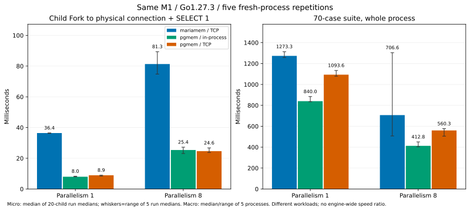

# 同じM1でのpgmem / mariamem：Forkと最初のSELECTまで

**このM1での70件は、pgmem約0.41秒、mariamem約0.71秒でした。pgmemもTCPへ
揃えると約0.56秒です。** 公開204msとの差から、そのままMariaDBの性能比を決める
根拠にはなりません。一方、同じ小さな入力で子DBを使えるまでの差は残り、
主に**Fork APIが返るまで**の区間に現れました。

次に進めるなら、mariamemのFork開始→API return内を限定調査することを勧めます。
接続や初回SELECTだけを最適化して全差が消える見込みは、この観測からは薄いです。
最強の制限は、70件のSQL/検証/seed配置がエンジン間で一致していないことと、
mariamemの全体時間の振れです。CPU・GC・コピー等の内部原因は未特定で、
最適化や性能上の受理、main統合は今回の決定に含めません。



## 70件のベンチを同じホストで測る

Go1.27.3 / GOMAXPROCS8、各5回のfresh process、各セル別warmup1回。
秒、中央値（最小–最大）。起動・準備・SQL・終了までを含み、ビルド/取得は含めません。

| 並列度 | mariamem / TCP | pgmem / 元のin-process | pgmem / TCP変更版 |
| ---: | ---: | ---: | ---: |
| 1 | 1.273 (1.258–1.314) | 0.840 (0.835–0.884) | 1.094 (1.079–1.134) |
| 8 | 0.707 (0.507–1.304) | 0.413 (0.404–0.450) | 0.560 (0.505–0.577) |

8並列の中央値比はmariamem/pgmem元経路で約1.71、TCP同士で約1.26。
これは別のアプリ実装同士のwhole-suite値で、engine全般の速度比ではありません。
TCP同士の各対はmariamemが2/5対で短く、3/5対で長く、分布も重なっています。
1.304秒のmariamem実行も削除していません。

pgmemだけの接続変更では、TCP版が8並列の全5対で長くなりました。
中央値は0.413→0.560秒（約36%増）。この比較は同じGoテスト/seed/設定のまま、
`cfg.DialFunc = s.Dial`の1行だけを使わないdisposable copyです。
変更前後hashは[inputs.json](forkcompare/results/inputs.json)の`macro_tcp_delta`に保存。
公式source cloneは変更していません。

[公開pgmem結果](https://shibukawa.github.io/pgmem/benchmarks/)はM3・Go1.27.0・204ms。
今回固定した公開版v1.18.2のrepoにも同じ204.14msの履歴がありますが、今回のM1実行は
Go1.27.3、実行時点も異なり、その履歴は計測source SHAを記録していません。
**0.413/0.204をM1/M3のCPU性能比とは解釈しません。**
前のmariamem測定はGo1.26.10で、今回と別cohortです。過去receiptは貼り替えません。

## 小さな同等入力でFork→接続→SELECT1を分ける

両者とも`fork_probe(id INTEGER PRIMARY KEY, v INTEGER NOT NULL)`に1,000行を準備し、
Snapshot後に元DBを閉じます。各processで20個の子を作り、worker数1/8で上限を固定。
pgmemのSnapshot capも同数で、待ち行列に入る前のworker取得はFork timerへ含めません。

1. 公開`Snapshot.Fork`を呼んで返るまで。
2. driver設定・pool作成と`db.Conn(ctx)`による最初の物理接続まで。
3. 同じ接続で`SELECT 1`を実行し、値1を受け取るまで。

公開APIの内部ready条件は同一とは限りません。**合計のreadinessが利用者視点の比較**で、
Fork列だけをbare copyの性能として扱いません。SQL driverは各DBの通常のdriverで、
pgxの既定query protocolやMySQLの認証/初期化の差も測定範囲に含みます。

ms。各processの20子の中央値を取り、その5processの中央値です。
各列は独立した中央値なので、足し算で合計を厳密に分解しません。

| 並列度 | 経路 | Fork return | 接続 | 初回SELECT1 | Fork開始からSELECT1成功 |
| ---: | --- | ---: | ---: | ---: | ---: |
| 1 | mariamem / TCP | 35.45 | 0.73 | 0.22 | **36.41** |
| 1 | pgmem / in-process | 5.02 | 2.68 | 0.19 | **7.98** |
| 1 | pgmem / TCP | 5.05 | 2.92 | 0.40 | **8.91** |
| 8 | mariamem / TCP | 68.10 | 4.28 | 0.77 | **81.34** |
| 8 | pgmem / in-process | 15.34 | 8.08 | 0.31 | **25.36** |
| 8 | pgmem / TCP | 14.18 | 7.65 | 1.27 | **24.65** |

直列のTCP同士でreadinessは約4.1倍ですが、接続はmariamemの方が短く、
約30msのFork return区間差が観測されています。8並列でも差は主にFork列へ現れ、
TCP/pipe差の大小から全体差を単純には説明できません。
**費用が現れる区間の特定までが結論**です。Fork内部のどの処理が原因か、
API契約を維持して削れる費用かはprofilingしていません。

readiness計測後に毎回COUNT=1,000 / SUM(v)=500,500を確認し、id1を更新/commitして
自分の行を検証します。後続・並列の子が初期状態で始まることも同じoracleで確認。
SQL poolと子を閉じ、mariamemの物理接続退役を待ち、最後にSnapshotを閉じます。
初期データ破壊のnegative controlは3経路とも失敗し、owned cleanupが成功しました。

## 固定入力と比較の限界

| 対象 | source_commit | tag_object_sha |
| --- | --- | --- |
| mariamem v0.6.0 | `b3b3b46a8807482ad3f96725af86e031fe369b01` | `b57183b08d48884840111e8b53daa500734337f0` |
| pgmem v1.18.2 | `a61005d37d01e6671f814fe8ca828222e8147df4` | `145e5d2fc70983b89a4bdd8438e547fcd60244ed` |

型付きidentityを`git_identity.py`で検証し、clean sourceからビルド。
Go binaryを作ったharness commitは`4ae7a7ab`（完全SHAはinputs.json）。
全binary hash、Go build infoとmodule graph、harness/fixture/migration hashを保存。
実際のserverはMariaDB12.3.3、PostgreSQL18.3でした。
M1/16GiB/macOS27.2、CGO_ENABLED=0。Go1.27.3を共通使用したのは、
upstream modelcaseがGo>=1.27を要求するためです。

- macroのpgmemは元の5migration・view/trigger・master Snapshot後のsample入力を維持。
  mariamemは前の50read共有/20write分離の5表・full-seed Snapshot・各case前のCOUNT/SUM
  oracleを維持。read baselineに追加Fork1個が必要です。SQLやoracleが同じとは主張しません。
- microは同じDDL/整数行ですが、Snapshotの保存対象やengine内部は同じではありません。
  microとmacroは別go.modです。第三者依存graphもinputsへ保存し、microのphaseを
  macroから引いて全体時間を再構成していません。
- 実行順は3経路を反復ごとにrotate。通常のOS活動は残り、厳密なCPU隔離/thermal統制、
  memory/GC campaign、Ubuntuや別ホストの再測定はありません。
- 600 measured micro childrenと2,100 measured macro casesが成功。
  別warmupは120 children/420 cases、計72process。pilotは別集計。
  上限はactive2時間/tooling30分/heavy CI0、workspace12GiB/free reserve16GiB。

## 保存・再検証・pilot保存の訂正

[raw evidence](https://github.com/masahitojp/mariamem/tree/ccbc62a2bb4ae2aae967de2b182d8a3a4df5935b/benchmarks/forkcompare/raw)
はSHA固定の別refへ保存し、この提案のtreeから外しています。
[archive.json](forkcompare/results/archive.json)がrefとmanifest digestを固定します。
採用する場合もraw/探索履歴をmergeせず、compactな最終treeだけを別判断します。

初期driverにはpilotとmatrixの保存名衝突があり、初期micro pilot正例3件の詳細が
matrixで上書きされました。**その3件のrawは利用不能**で、wall/count等のmetadataのみ
初期receiptに残っています。macro pilotとnegative controlは退避して保持できました。
この不備を[driver-correction.json](forkcompare/results/driver-correction.json)とraw内の
`initial-pilot-preservation.json`に記録しました。衝突を直したdriverでpilot全9件を再実行し、
3正例・3負例・3macroが期待どおり終了。再実行前後で全72matrix raw hashが同一であることを確認。
初回の遅いpilot wall値もrawのmetadataへ残し、warmupや通常測定へ読み替えません。

所有workspace prefixは`<WORKSPACE>`へ置換し、変更前後hashを
[publication.json](forkcompare/results/publication.json)へ保存。数値/source identityは変更なし。
compactな[observations.json](forkcompare/results/observations.json)から、build/tempなしで
要約を再計算できます。既存の要約やinputsを上書きしないcheckです。

```sh
python3 benchmarks/forkcompare/analyze.py --evidence-dir benchmarks/forkcompare/results --check
```

元のrawを検証する場合は、archive.jsonのcommitから該当rawディレクトリをexportし、
manifest digestと各hashを照合後、`analyze.py --collect /path/to/raw --output-dir /tmp/recheck`
で抽出・集計し直せます。新しい計測にはplan/pinsとrunnerをprepared workspaceへ置き、
まず`temp/product`をmariamemの固定commit、`temp/pgmem`をpgmemの固定tag/commitへ
checkoutしてclean状態にし、rootの`source-pins.json`を`evidence/`へコピーします。
runnerはcloneの型付きidentityを再検査してからビルドします。
build→pilot→matrixをdisk guardで実行します。再計測は新cohortで、元の観測を置き換えません。
[CSV](forkcompare/results/summary.csv) / [JSON](forkcompare/results/summary.json) /
[checksums](forkcompare/results/SHA256SUMS.json)。
