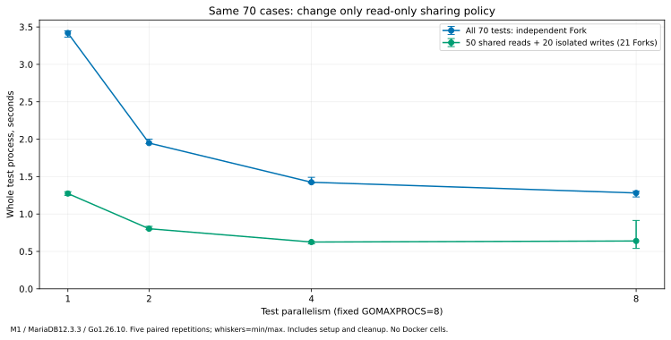
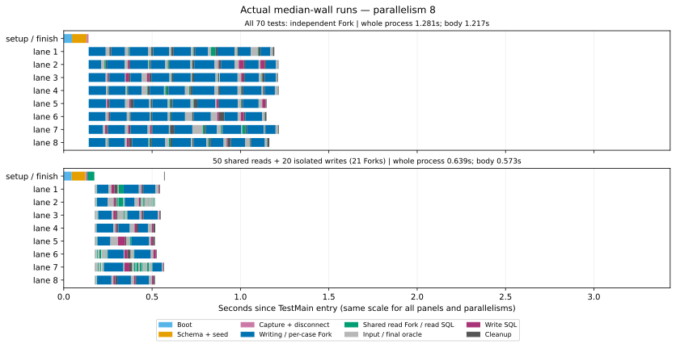

# 読み取り共有でどれだけ変わるか：70 Fork 対 21 Fork

**同じM1上で、読み取りを共有するだけで全体時間が約50〜63%短くなりました。**
各ケースをすべて隔離する構成と、read-onlyを共有する構成では、同じ70件でも費用が大きく違います。
まずこの2つを区別して説明することを勧めます。product code/APIは変更していません。

主な制限は、pgmemと完全には揃えていないことです。マシン、SQL/検証、Snapshotのseed境界、
connectionモデルに差があるので、残る差をM1/M3やengineの性能比に読み替えることはできません。
今回確認できたのは、**同じmariamem・同じアプリ・同じマシンでの共有方針の効果**です。

## 全体時間：今回の対比較

秒、各5回の中央値（最小–最大）。全件Forkも今回の同じバイナリで測り直し、順番を交替。
各セルの別warmup1回は除外。起動・準備・70件・最終検証・cleanup・プロセス終了までを含み、
compile/downloadは除外します。外側driverのwait/JSON出力等も含むため、単体APIのsub-ms測定ではありません。

| テスト並列度 | 全70件をFork | read50件を共有＋write20件をFork | 中央値の短縮率 |
| ---: | ---: | ---: | ---: |
| 1 | 3.419 (3.364–3.448) | **1.273** (1.249–1.298) | 62.8% |
| 2 | 1.948 (1.942–2.001) | **0.803** (0.792–0.835) | 58.8% |
| 4 | 1.424 (1.413–1.491) | **0.625** (0.601–0.630) | 56.1% |
| 8 | 1.281 (1.228–1.304) | **0.639** (0.540–0.914) | 50.1% |

短縮率は中央値同士から算出。各対の比も[summary.json](modelcase/shared-read-results/summary.json)へ保存し、
全20対で共有版が短くなりました。rangeは観測範囲であり、信頼区間ではありません。
共有版の4→8並列は中央値では改善せず、8のばらつきも大きくなりました。

前回の全件Forkの8並列は約1.70秒、今回は約1.28秒でした。時点/バイナリ/cohortが違う結果を
混ぜて短縮率を作っていません。旧結果は[元の3方式比較](parallel-modelcase.md)にそのまま残し、
Testcontainersも今回は再実行していません。この表は新しい2方式の同時点対比較です。

## 実際のタイムライン

各セルの全体時間が中央値だった**実際の実行**です。同じ縮尺で、ゼロはTestMain開始。
プロセス全体の前後の費用は別途whole-process値に含みます。重なるspanの合計はwall timeではありません。

[並列度1](modelcase/shared-read-results/plots/timeline-p1.svg) /
[2](modelcase/shared-read-results/plots/timeline-p2.svg) /
[4](modelcase/shared-read-results/plots/timeline-p4.svg) /
[8](modelcase/shared-read-results/plots/timeline-p8.svg) /
[全図の単独HTML](modelcase/shared-read-results/comparison.html)（ダウンロード後ブラウザで開く）。

### 減った費用と残る費用

- 並列度1の代表実行で、全件Forkの取得区間は合計2589ms/70回。
  共有版はwrite取得755ms/20回＋read用取得36ms/1回。write1回あたり約38msで、
  全件版の約37msより取得そのものが高速化したわけではありません。回数とread側の再利用を変えた結果です。
- 子のcleanup合計も約240→60ms、入力oracle合計は約319→187msでした。
  共有版には最後のread DB検証とそのcleanupも追加して含めています。
- 並列度4の共有版でもwrite取得区間の合計は約949ms/20回、read用取得は約42ms。
  初回boot/schema/captureには約137msかかっています。Fork・接続/Ping、SQL・検証の費用が残っています。
- 8並列では取得・SQL/検証の重複区間が長くなる観測がありますが、CPU/GC/memory/engine内部を
  分離したprofilingはしていません。phaseの重複合計を全体時間から引いて原因を断定していません。

取得区間は公開helperの`DB(t)`で、permit取得、Fork、pool作成、Pingを含みます。
pgmemのbare Fork timerとの直接比ではありません。

## 変更した実行モデル

アプリのSQL/seed/期待値を持つ`app.go`は前回から同一hashです。
引き続き50read＋20committed-write、5表、20categories/500products/1000users/40orders。
各ケース前のCOUNT/SUM oracleと処理後の行検証も維持しています。

| 条件 | 全件Fork | 共有read版 |
| --- | --- | --- |
| baseline準備 | 全seed入りSnapshotを1回 | 同じ |
| 読み取り50件 | ケースごとに独立した子 | 親テスト所有の子DB1個を共有 |
| 書き込み20件 | ケースごとに独立した子 | 同じ |
| 子の取得回数 | 70 | **21** |
| MaxForks | P | **P+1**（read用の子を親が保持） |
| consumer pool | 子ごとに最大1接続 | read用は最大P接続、write用は各1接続 |

Pは`-test.parallel`、GOMAXPROCSは両方式とも8です。Go helperの既存public APIを使い、
library内部やcapacity制限を変えていません。read用は`Fixture.DB(parentT)`、write用は
`Fixture.DB(childT)`で所有し、親のcleanupは全subtestの終了後に走ります。
P+1は親子のpermit枯渇を防ぐためで、両方式の最大保持DB数が同じという主張ではありません。

共有readは**このベンチでの明示的なread-only分類**であり、新しいread-only API/権限制御ではありません。
共有DBにはこのcase群のSELECTと初期状態oracleだけを流し、終了時にもpristine oracleを実行。
任意アプリの「read-only」宣言を自動的に安全化する機能としては扱いません。

## 検証と固定入力

pilotは両方式70件を完了。corrupt-seed controlは開始前のoracleで失敗、
read-mutation controlは1件のread直後に意図的にpriceを書き換え、親の最終oracleが検出しました。
後者ではcase自体が成功してもsuiteは失敗し、どちらもowned cleanupが成功しています。
期待した失敗は[negative records](modelcase/shared-read-results/pilot/)へそのまま保存。

本計測40suite/2800cases、別warmup8suite/560casesが完了しました。
全case名/結果、取得イベント70対21（共有版のwrite20＋read baseline1）、最終read pristine、
slot非重複、同時case数上限を事後検証。実際のpeakはP=1/2/4/8でした。
これは有限のデータ/所有者検証であり、一般的なread-only enforcementやleak不在の証明ではありません。

- product: v0.6.0、source_commit `b3b3b46a8807482ad3f96725af86e031fe369b01`、
  tag_object_sha `b57183b08d48884840111e8b53daa500734337f0`。`git_identity.py`で型とclean checkoutを検査。
- tested harness source_commit `5f9516b0338c4fc87935eaa2fa612c5ae88ef22e`。
  実際の完全SHAは[inputs.json](modelcase/shared-read-results/inputs.json)を正本とする。
- M1/16GiB/macOS27.2、Go1.26.10、CGO_ENABLED=0、mysql driver1.9.3。
  同一binaryと交替順序で各5対。Dockerのセルやheavy CIは今回0回。
- binary・module/SQL/harness・driver/analysisのhash、raw timing、per-pair ratiosは保存済み。
  本計測後のcode/docsを古いharness SHAの新しい受入証拠として貼り替えていません。

## pgmemとの比較でまだ揃っていない条件

[公開pgmemのmodel-case](https://shibukawa.github.io/pgmem/benchmarks/)に近いread共有モデルになりましたが、
同じベンチではありません。pgmemはM3、20 Forkで元serverをreadに使用し、masterのみのSnapshot後に
sample入力を用意します。こちらはSnapshotが準備DBをconsumeするのでread用にも1 Forkが必要で、
full seedをSnapshotへ含めた前回の境界を維持しています。SQL/schema/追加oracleも異なります。
また、pgmemの説明ではshared readは1 backend session、こちらのread pool上限はPです。

したがって、この結果からpgmemの公表204msに対するCPU速度比やengine比を算出しません。
**大きな構成差を取り除くと、このM1でも約0.63秒まで短くなる**ことが今回の結論です。
残る差を切り分けるなら、同じmachineでのupstream再測定や、取得/接続/SQL区間の追加観測を
次の限定タスクとして設計します。今回の結果を合わせるための追加最適化やAPI変更は行っていません。

[全結果CSV](modelcase/shared-read-results/summary.csv) /
[raw suite](modelcase/shared-read-results/matrix/) /
[trace検証](modelcase/shared-read-results/trace-validation.json) /
[checksums](modelcase/shared-read-results/SHA256SUMS.json)。
再現は保存した[driver](modelcase/shared-read-results/run.py)をprepared workspaceの`evidence/`へ置き、
pilot→matrix、その後[analysis](modelcase/shared-read-results/analyze.py)を実行。
active2時間/tooling30分、workspace12GiB/free reserve16GiB、heavy CI0回の境界を使い、
結果保存後はcompiled/cache/clone/worktreeをcleanupします。
