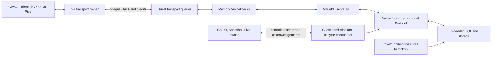

# Issue 65 — embedded engine with native protocol I/O

2026-11-05. **Design proposal only.** The Human requested step 3 design after
steps 1 and 2. This document authorizes no implementation, adoption or release.

Subsequent evidence: [3C generated-Go execution](../../../benchmarks/spikes/issue65-go-wire/README.md)
and the [3D stopped-root design](snapshot-fork.md). The original proposal below
retains its original evidence/decision context.

## Recommendation and decision boundary

Keep an embedded engine and introduce a native wire session through a memory
Vio. Select embedded-C-API versus native-wire behavior once per THD, before
login; retain the embedded C API for bootstrap. Put command admission and the
Snapshot barrier inside the guest. The host relays opaque bytes and owns
transport and instance resources. This meets the original aim: MariaDB owns
parameter decoding, command semantics and normal response serialization.

Recommend a bounded **native output/login proof first**, if the Human later
selects implementation. Do not begin a full WASIX port yet. Step 2 establishes
real native parameter decoding in an embedded THD; it does not establish native
Protocol output or native login in this build. The strongest objection is the
number of conditional compilation and lifecycle seams needed to make those
paths coexist. A per-connection Vio callback alone cannot accomplish this.

Snapshot/Fork is **architecturally compatible in principle, runtime unverified**:
current Snapshot captures stopped filesystem state and Fork starts a fresh
runtime. Neither requires cloning a running THD, socket or protocol stream. The
new workers and I/O pumps must nevertheless be stopped and joined before capture.

Two product choices remain open before adoption: how to preserve the current
fatal-cause wire diagnostic, and whether malformed EXECUTE strings should retain
the unchanged native decoder's acceptance as empty. Neither is silently approved
by this proposal. Subsequent implementation of even the first proof is a separate
Human selection; current stable behavior remains the baseline.

## Evidence and identities

| Basis | Exact identity and scope |
| --- | --- |
| Product runtime source | `47121e1be0b399ba4e2270ce3e25c411ade0e2eb`, published 0.6.2 source |
| Current main inspected | `0c4e75dc2c21421a59d04661efd72a1f58efecaa`; runtime/guest paths inspected here match the experiment base except guest/experimental.patch |
| Design starting source_commit | `c3c3fb5e18dd1668e3db2439a0f705da237b1685` on experiment/issue65-native-packet |
| MariaDB source_commit | `83e909fc2a0dbc394b4b683fb3fa2d7dcf26cc5e` (12.3.3) |
| Step 1 | [NET read fixture](../../../benchmarks/spikes/issue65-vio-read/README.md): 15 groups over memory callbacks, extracted functions, not a full server ABI |
| Step 2 | [Real embedded prepared input](../../../benchmarks/spikes/issue65-prepared-native/README.md): seven native decode entries, null client_params, actual SQL; native Linux/arm64, minimal storage profile |
| Upstream inspection | [11-file manifest](upstream-files.json): fixed commit, Git blob and SHA256 checked; source reading only |

This design adds no engine patch, build, benchmark, CI submission or runtime
acceptance. The step 2 experimental.patch remains historical experiment state;
its global borrowed packet and library-wide native input selection must not be
used as the implementation of this design. The old
[initial relay memo](../../reviews/v06x-wire-relay-feasibility.md) and
[#65](https://github.com/masahitojp/mariamem/issues/65) keep their historical scope.

## Target ownership

The two planes may share existing stdin/stdout OS pipes with a new versioned
multiplexing envelope. They are logically separate: DATA contains uninterpreted
MySQL bytes; control contains no SQL strings, parameter values, columns or rows.
This is still a private transport protocol, but it no longer duplicates MySQL
command or result semantics. No guest OS listener, Sock_open implementation or
cgo boundary is required by this proposed shape. Whether the resulting C/C++
callbacks and blocking operations compile through WASIX/wasm2go remains untested.

| Owner | Responsibility |
| --- | --- |
| Host | TCP/Pipe admission, 16-slot reservation, byte pumps, pending-input budget, timers, early fatal notification, final join and backing ownership |
| Guest coordinator | Session identity/generation, command admission, authoritative busy/transaction state, atomic quiescence, close acknowledgement |
| Native MariaDB | Handshake parsing/encoding, negotiated command semantics, prepared IDs and types, native text/binary/OK/ERR/EOF responses |
| Memory Vio | Partial byte reads/writes, EOF/error, wait/wakeup and deadlines; no MySQL header or SQL parsing |
| Embedded bootstrap | Existing fresh/restore checks, routines and key preparation before external admission; its MYSQL handles close before ready |

The ordinary data path no longer uses host prepared-ID maps, typed parameter
requests, JSON/hex rows or a host result serializer. Do not remove their existing
implementations during the first experiment; production extraction is a later
explicit scope.

## One coherent build, two fixed session modes

Use one opt-in build flag, provisionally MARIAMEM_NATIVE_WIRE, alongside
EMBEDDED_LIBRARY across the complete hybrid build. Never undefine EMBEDDED_LIBRARY
for selected translation units. THD, NET, Protocol and their headers must have
one consistent layout in every translation unit.

Add a THD mode (provisional names EmbeddedApi and NativeWire), initialized as a
constructor value before the direct Protocol members and immutable thereafter.
Existing C API callers retain the EmbeddedApi constructor default. It is independent of current
text/binary Protocol selection. Native SQL execution explicitly assigns
thd->protocol_binary, and metadata emission constructs local Protocol_text
objects; both must select the session's sink. Merely assigning an external
Protocol subclass does not cover these paths; Protocol_binary is final.

Keep one public definition for each existing Protocol method. Isolate embedded
bodies under named embedded helpers; enable existing native bodies and put a
small mode branch at the actual differing methods. Move code rather than copy
and rewrite its encoders. Low-level binary packet builders are shared where
already identical. Inventory both definitions in lib_sql.cc and protocol.cc,
including inherited/overridden methods, before editing.

Required output differences include net_store_data(_cs), text field metadata,
send_result_set_metadata, prepare_for_resend, NULL storage, write, flush and
OK/ERR/EOF. Protocol_binary::write must route native sessions to the native NET
writer and embedded sessions to the existing MYSQL_ROWS collector. Ensure native
error paths never fall into lib_sql.cc's `if (!thd->mysql)` bootstrap handling.
Retain embedded dataset helpers only for EmbeddedApi. Native code must have no
MYSQL_DATA/JSON result collector dependency.

Prepared_statement keeps both parameter-assignment strategies in the hybrid
profile and selects by immutable THD mode. NativeWire uses upstream packet
conversion, type reuse and native long-data/ID state; EmbeddedApi preserves
MYSQL_BIND semantics. Numeric/string/temporal setters currently select wire
versus embedded representations at compile time: these also need mode-aware
selection, including byte order, length-prefix handling and MYSQL_TIME conversion. Setters
without an explicit THD argument can consult the owning current_thd TLS; they
must not use a library-global mode or borrowed input pointer.
Use the existing implementations; do not transplant the step 2 global switch.
Native PREPARE response emission must also choose its upstream wire form instead
of updating the embedded client's fields. Long-data has a separate embedded
extra_data fork; decoding EXECUTE alone does not close that gap.

NET in the hybrid endpoint needs **server** error/sequence semantics. net_serv.cc
currently redefines MYSQL_SERVER to MYSQL_CLIENT when embedded; step 1 therefore
observed a client-side previous-sequence ERR exception. Enable the server NET
profile deliberately without changing THD's embedded layout, and ensure private
bootstrap never uses a remote-client NET path. Test native error reporting,
sequence rejection and packet reuse again; do not reuse step 1 PASS as this proof.

## Session startup, authentication and retirement

One resident worker owns each wire THD, TLS/current_thd, native statement map and
Vio for its entire physical connection. Start with the existing 16-worker model;
no threadpool scheduler or nonblocking dispatch resume is proposed.

1. Host reserves a slot before OPEN and assigns an instance epoch and monotonic
   session generation. Generation exhaustion fails closed; late frames cannot
   address a reused slot.
2. Worker initializes thread/TLS state, creates a fresh NativeWire THD and installs
   Vio/NET before handshake. Reuse/factor common initialization from embedded and
   native connection helpers. Do not call create_embedded_thd (which already
   initializes queries) and then initialize the same state a second time.
3. Reuse native login helpers (target: thd_prepare_connection/login_connection and
   acl_authenticate) without the native accept loop. Their excluded source and
   declarations need coherent enabling or extraction of shared helpers. If this
   pulls in the whole listener/scheduler, stop and reassess the first proof.
4. Set synthetic peer metadata explicitly to the local test endpoint. Do not
   claim a real socket or encrypted/secure transport. A memory Vio type and its
   description/type/info handling need an audit, not an arbitrary socket FD.
5. Run native handshake and native initial database/charset setup. No host-built
   greeting or hand-crafted handshake decoder belongs on the normal path.
6. Each command runs on that worker in blocking native dispatch. On retirement,
   stop further admission, release statements/transactions on the owning thread,
   free NET/Vio/THD exactly once, remove server_threads registration, finish TLS,
   and let the coordinator join the worker before acknowledging RETIRED. The
   worker's own cleanup-done notification is not proof that its thread has exited.

Preserve the current local-test credential contract: arbitrary placeholder
username/password, full fixed test privileges, no account authentication promise.
Upstream NO_EMBEDDED_ACCESS_CHECKS has a native-password success path and an
uninitialized-grant shortcut; that is source evidence, not a working login test.
It does not by itself prove greeting, database selection or identity compatibility.
Use native parsing, then keep the effective SQL identity canonical to the current
root session rather than letting ignored client usernames choose accounts or
change USER()/CURRENT_USER() unexpectedly. Check the credential matrix, empty
username, both existing response encodings, initial DB, charset and malformed
handshakes. No TLS, compression or extra auth plugin is advertised; native server
default capabilities must not leak into the greeting.

No-response commands (QUIT, STMT_CLOSE, SEND_LONG_DATA) finish by dispatch return
and lifecycle hooks, not by finding an OK packet in the output stream. STMT_CLOSE
must not gain a synthetic reply. Session reset, cursor and admin paths are not
silently enabled because dispatch_command contains handlers for them.

## Thin transport and flow control

Provisional internal messages are READY(profile/build), OPEN, DATA, CREDIT,
OUTPUT_WRITTEN(offset), SESSION_STATE, CLOSE, RETIRED, TRY_QUIESCE, QUIESCED,
REJECTED and SHUTDOWN. Every session message includes instance epoch, slot and
session generation; data offsets are monotonic per direction. Control operations
have request/epoch correlation. Repeated or stale operations must not retire a
new session or commit an old capture. Exact byte encoding belongs to the proof,
not a new public API or a reuse of the unversioned SQL request meanings.

Reuse the current pipes initially. C callbacks consume/produce bounded guest
queues using normal guest pthread condition variables; generated Go only needs
existing read/write/thread machinery if this compiles. Do not assume exported Go
function pointers can be passed directly to translated C. No new WASIX import
is justified until a minimal guest compilation identifies a specific missing seam.

Suggested private chunk/window size: 64 KiB output credit per connection; input
credit uses the existing **1,048,581 pending raw bytes** per physical connection.
The latter is a byte budget, not a command count. Account for host queues,
framed bytes in transit and guest input not yet consumed by NET as one outstanding
credit ledger; refund on actual consumption, not on receipt of a DATA envelope.
Bound physical buffer capacity and metadata too; do not allow capacity growth
past the budget by appending slices. Native current-command/NET and result memory
are separate costs, so this is not a whole-process memory claim.

Host read monitoring continues when credit is full, retaining one overflow
observation byte. Overflow during execution keeps the accepted instance-abort
policy; waiting for credit without checking EOF is not equivalent. Bytes for
future commands may queue, but each still passes guest admission before execution.
Per-session output credit permits streaming without collecting a whole JSON result.
A stalled client parks only its own writer, within its deadline.

The host must always demultiplex guest output independently of client writes.
Never block the shared reader on one slow client. Bound each queue; control and
credits have reserved scheduling capacity, and a full DATA queue must not block
CLOSE, QUIESCE or failure observation. One output arbiter serializes complete
internal frames, with bounded DATA chunks and fair per-session scheduling.
Control is prioritized after the current bounded frame. No guest admission or
instance mutex may be held while waiting on network output or pipe backpressure.
A scheduler/control starvation or cross-session head-of-line block is a failed
proof, not an accepted simplification.

Vio implements read/write, retry/timeout/errno, wait, shutdown/close, connection
state, blocking/fastsend/keepalive and peer/type metadata as actually called.
my_net_init calls fd/blocking/fastsend helpers too. The native compile/run must
show no syscall on a fake FD. EOF wakes blocked readers; close wakes readers and
writers; timeout is distinguishable from EOF; callbacks return no more than the
requested byte count and support partial transfers. These are required semantics,
not a claim that the preceding source-extraction fixtures already tested them.

## Native policy hooks and bounds

Use small policy hooks at upstream decoded boundaries, not another host parser:

- Preserve advertised bits from the current endpoint and its conditional prepared
  result flag. Preserve the current accepted FOUND_ROWS path even though it is
  not in the base advertised set. Do not use the upstream default capability set.
- Keep supported commands1,2,3,14,22–27 initially. Reject other commands at native
  dispatch with native error serialization. TLS, compression, packet continuation,
  DEPRECATE_EOF, cursor/admin/replication and LOCAL INFILE remain outside the
  declared profile. A later scope expansion is a separate product choice.
- Preserve 1MiB SQL and current command-specific prepared/long-data bounds. A
  blanket command-frame cap is not a substitute for their different body limits.
  Read source-bounded bytes first; perform policy checks on upstream decoded
  lengths and command kinds, without decoding parameter values a second time.
- Check incoming frame length at every native header boundary, before allocation
  or payload read. NET's net_realloc limit alone is insufficient: it runs only
  when the cached buffer is too small. Reject continuation at this boundary too.
  Keep the current maximum response payload0xfffffe; do not silently enable
  upstream packet splitting or larger output by virtue of native my_net_write.
- The current typed/JSON bridge also has internal 32MiB envelope constraints.
  Streaming removes that representation; aggregate-output error behavior and
  long-data accumulation need an explicit compatibility disposition before
  adoption. A 64KiB transport window does not bound engine row/result allocations.

The truncated EXECUTE string seen in step 2 is a named semantic difference, not
an automatic excuse to reconstruct a second decoder. For the first proof record
it unchanged and compare the pinned native reference. Before adoption choose
upstream-compatible behavior or a minimal, separately justified upstream fix;
do not claim universal malformed-input rejection or silently restore host decoding.

## Atomic quiescence and Snapshot/Fork

Authoritative command admission and Snapshot inspection share one guest mutex.
Host SESSION_STATE notifications are useful for UI/timers but are not the
linearization point: a delayed BUSY notification must never allow capture to
race with an already-started command.

Session states: HANDSHAKE → IDLE → RECEIVING → EXECUTING → FLUSHING → IDLE;
any state may enter RETIRING/FAILED, ending in RETIRED. An idle worker blocked
waiting for its first command byte is IDLE. Returning that first byte to NET
atomically admits the command and marks RECEIVING under the guest gate, including
fragmented header/body input. Merely queuing future DATA does not execute it.

Once admitted, the command remains busy through native dispatch, every result,
NET flush and the host's OUTPUT_WRITTEN acknowledgement for its final output
offset. No-response commands use dispatch completion and the same state hook.
Only then may the worker release its command lease and publish IDLE plus actual
THD transaction status. Async notices cannot release a lease by themselves.
Handshake, partial packets, unresolved output and retirement all count as busy.

Proposed TRY_QUIESCE(rollback) transaction:

1. Host temporarily gates new attach under its normal admission lock and sends
   the correlated guest request. A rejected request reopens admission. Do not
   close client sockets or request capture during this reversible phase.
2. Guest under the shared gate checks handshakes, command leases and cleanup.
   If busy, return REJECTED(busy), leaving sessions usable. If any actual THD
   has an active transaction and rollback=false, return REJECTED(transaction_active).
   Read stable owner-published status protected by the gate, never arbitrary
   live THD fields from a foreign worker. Server notifications alone are stale.
3. If checks pass, mark the instance QUIESCING under that same gate and return
   QUIESCED(epoch). All subsequent commands, including queued input, are fenced.
   Success is irreversible and consumes the source; rollback=false does not mean
   keeping its clients alive. New data cannot cancel the fence or enter SQL.
4. Host commits its stop state, requests capture before final cooperative guest
   shutdown, closes client transports with an expected-owner-stop reason, and
   wakes guest I/O waits. Expected shutdown must not be classified as a client
   disconnect during active SQL and poison the capture.
5. Owner workers retire, including rollback of uncommitted transactions when
   requested, then join. Call the existing engine shutdown path, then allow the
   generated runtime to join all workers, freeze the bound filesystem root and
   release descriptors/memory only after their users exit. TakeRoot/OwnRoot
   retain their existing build identity, seal and ownership checks.
6. Fork restores the root into a **fresh** runtime, performs restore validation,
   redoes bootstrap, and accepts new sessions. Do not serialize THDs, statement
   handles, queued bytes, session generations, sockets or locks into the baseline.
   Live replacement also starts fresh physical sessions; it does not migrate them.

A timeout or lost control acknowledgement after TRY_QUIESCE was sent is an
ambiguous outcome: the guest might already be fenced. Never return a reversible
precondition rejection or re-enable admission on that ambiguity. Fail closed,
consume/retire the source, and return no baseline unless capture and join complete.
Duplicate requests use their epoch result; they cannot create two baselines.

Snapshot/Fork go/no-go requires: no post-fence SQL side effects; busy/transaction
rejection leaves the source usable; rollback excludes uncommitted changes; idle
prepared sessions cleanly retire; slow/partial I/O cannot deadlock capture;
join precedes freeze/release; children isolate writes and survive baseline Close;
Live reservations and capture-debt rules remain intact. Until those are measured,
Snapshot capability on the experimental endpoint is disabled, not claimed from
passing a simple SQL query.

## Deadline, disconnect and fatal behavior

Guest admission starts the command deadline before a partial header can stall.
Maintain separate handshake, command and output deadlines. Use monotonic command
IDs/generations for timers; a late completion must not cancel a newer timer.
The guest checks local deadlines at the same admission point; host notification
latency must not leave a command without a bounded lifetime. A host watchdog
remains necessary for guest failure, using the existing instance abort semantics.

An unexpected EOF while RECEIVING/EXECUTING/FLUSHING, read-ahead overflow or
command deadline terminates that instance as today; ordinary SQL errors permit
the next command. Idle disconnect normally retires only its session. Ordering
between disconnect and owner-stop uses the shared admission/control protocol,
not a guess based on a later status notice. Independent DB roots remain separate.
Fatal notification wakes every wait and completes pending calls promptly, but
never releases storage still owned by a non-cooperative generated-Go worker.
The existing inability to forcibly stop such a worker is retained as a limitation.

**Unresolved adoption blocker: fatal diagnostics on the wire.** Current
TestIdlePingRejectsFailedInstanceWithOriginalCause expects ERR2013/HY000 containing
the original worker trap on a subsequent idle PING. An opaque relay cannot safely
ask an already failed guest to serialize that packet, or inject it at an unknown
sequence/response boundary. Recommend socket EOF plus the original cause on the
owner API/logs for this architecture, subject to an explicit Human contract
decision. If exact wire diagnostics are mandatory, design a separately bounded
host failure responder and include its framing/sequence cost; it is retained
wire code, not a free consequence of relay. The first isolated native proof can
proceed without changing this product contract; adoption cannot pass by deleting
or weakening that existing regression.

Likewise, 17th-connection rejection must remain bounded and independent of a
free SQL slot. A small native pre-login rejection context or the existing fixed
host admission-error helper may serve that path; choose and test it before
adoption. It is distinct from interpreting every normal SQL result on the host.

## Ordered proofs and stop conditions

These are proposed future scopes, not work started by this design.

| Stage | Smallest deliverable | Stop / continue rule | Cost envelope before starting |
| --- | --- | --- | --- |
| 3A | Coherent native Linux library with private embedded bootstrap, one memory-Vio native greeting/login, text SELECT with metadata/NULL/error, wire PREPARE/EXECUTE/CLOSE with native output, disconnect and a second session after retirement | Continue only if all normal bytes are emitted by upstream Protocol/NET, client_params remains null for wire sessions, C API bootstrap still works, class layouts are coherent and resources retire; missing symbols/output forks are reported, not replaced by bespoke encoding | Start with 2 active hours, tooling30min, CI0, disk6GiB/free8GiB; likely several further hours if output refactoring is broad; stop at initial budget and report patch inventory before expanding |
| 3B | Two concurrent native sessions, bounded transport, pipeline order, no-response controls, 16-slot retirement, authority-gate race and stop tests | Continue only if slow client/output cannot block control or other sessions; stale generation/control acknowledgements fail closed; native sequence and size guards hold | Separately selected 2h bounded probe, CI0; do not couple it to WASIX rebuild |
| 3C | Minimal WASIX build and generated-Go end-to-end endpoint through the same memory queues | Continue only if fixed guest source/provenance, callbacks, thread waits, EOF and worker-failure/join behavior work without guest OS networking; identify each new shim/import | Select only after 3A/3B; preflight build recipe/resources, initial 2h tooling/link assessment, CI0; a complete build/campaign cost is not yet known |
| 3D | Actual stopped-root Snapshot/Fork/Live plus declared consumer/profile acceptance | Adoption go/no-go only after the quiescence/rollback/ownership conditions above, auth/fatal/bounds dispositions and both-platform evidence | Separate costed campaign after 3C; no estimate of cheap completion is justified by the native arithmetic probe |

Record source commit, actual flag/layout/profile, upstream patches, platform,
functional failures, semantic differences and cleanup at every stage. If a stage
is inconclusive, list its missing evidence and concrete next cost. Do not turn
it into a whole-server port or extend the campaign automatically. Performance
claims require later matched old/new/native measurements (transport CPU/copies,
startup, memory and Snapshot/Fork); no speedup is inferred here.

## Detection and acceptance work

| Concern | Existing evidence/check anchor | New endpoint acceptance needed |
| --- | --- | --- |
| Framing/sequence and partial I/O | [Step 1 fixture](../../../benchmarks/spikes/issue65-vio-read/README.md) | Real server NET init, all required Vio callbacks, previous-sequence ERR rejection, warm-buffer size cap, EOF and output fragmentation |
| Prepared input/output | [Step 2](../../../benchmarks/spikes/issue65-prepared-native/README.md), mysqlwire prepared tests | Raw wire PREPARE metadata, EXECUTE binary rows, type reuse/NULL/unsigned/NUL, alias0xffffffff and zero-param flags, CLOSE/RESET/LONG_DATA no-response/error behavior |
| Credentials/profile | [Credential inventory](../../reviews/issue78-wire-inventory.md), tests/godefault/credentials_test.go | Bind the same driver matrix to the native endpoint; default capability leaks, canonical identity, malformed login and rejected TLS |
| Pipeline/control | internal/mysqlwire/pipeline_test.go, [accepted input budget](../../decisions/issue94-bounded-pipeline.md) | Existing tests call the old wire implementation; they do not detect a new relay bug. Add equivalent raw endpoint controls for overflow/EOF, output stalls, control priority, admission fences |
| TCP/Pipe capacity | tests/godefault/pipe_test.go | Same shared slot limit and retirement on both transports, including17th connection and late generation frames |
| Fatal cause/join | internal/mysqlwire/worker_failure_test.go, internal/generatedgo/runtime_instance_test.go | Wire diagnostic decision; native callback failure, blocked peers, early poison and actual joined teardown |
| Snapshot/ownership | internal/host/heap_snapshot.go, internal/host/snapshot_test.go, tests/godefault/memory_snapshot_test.go | Real native endpoint race barriers, expected-stop versus EOF, rollback, stopped-root capture, independent children, baseline Close and Live capacity/debt |
| Source/CI profile | guest provenance checks and current fixture contract | Current source/hash/capability lint is tied to the old route. Version its new profile explicitly; a green legacy job does not qualify the absent endpoint |

Do not run all runtime acceptance just to validate this design document. For a
future implementation choose the focused boundary at each proof, then the normal
production/release gates only when integration or release is actually selected.

## Source map for the proposed patch

All upstream paths below refer to source_commit83e909fc2a0dbc394b4b683fb3fa2d7dcf26cc5e;
line positions are for that original source, before the step 2 patch.

| Boundary | Upstream anchor | Required treatment |
| --- | --- | --- |
| Layout/session | sql/sql_class.h3376–3410; sql/protocol.h61,243 | Fixed per-THD mode; consistent headers/layout; direct text/binary objects and local metadata Protocol instances |
| Vio | include/violite.h201,240–280; vio/vio.c | Full callback/type/helper audit; no real listener or fake FD syscalls |
| NET | sql/net_serv.cc56–60,126,204,411,940–963 | Server semantics, real initialization, per-header bounds and native output without continuation leak |
| Output split | sql/protocol.cc41–75,205–478,810–823,1198,1311,1427; libmysqld/lib_sql.cc1017–1445 | Embedded helpers/native bodies plus mode branches; no duplicate public definitions |
| Login | sql/sql_acl.cc13766,13860,14369,15138,15511; sql/sql_connect.cc910–1557 | Native handshake/caps and no-access-check semantics; enable only needed connection helpers |
| Embedded lifecycle | libmysqld/lib_sql.cc108,439,705,773 | Bootstrap retains C API; factor initialization/cleanup instead of reusing MYSQL-dependent close on a wire THD |
| Command loop | sql/sql_parse.cc1179–1475 and dispatch1825 | Enable blocking native command wrapper; fence first byte, dispatch policy, completion hooks |
| Prepared forks | sql/sql_prepare.cc205,432,492–1267,3888–3930,4165,4606 | Mode-aware prepare response, conversion representation and assignment; remove spike globals |

Repository constraints: [Snapshot contract](../../decisions/snapshot-product-contract.md),
[wire scope](../../decisions/v060-wire-contract.md),
[0.6.2 protocol guide](../../mysql-protocol.md),
[runtime join ownership](../../../internal/generatedgo/runtime_instance.go),
[linked transport](../../../internal/guest/linked.go),
[resident workers](../../../guest/resident.inc),
[current Snapshot implementation](../../../internal/host/heap_snapshot.go).
Approved direction remains in project-status; this proposal does not rewrite it
or re-label any historical review as approval of the new endpoint.
