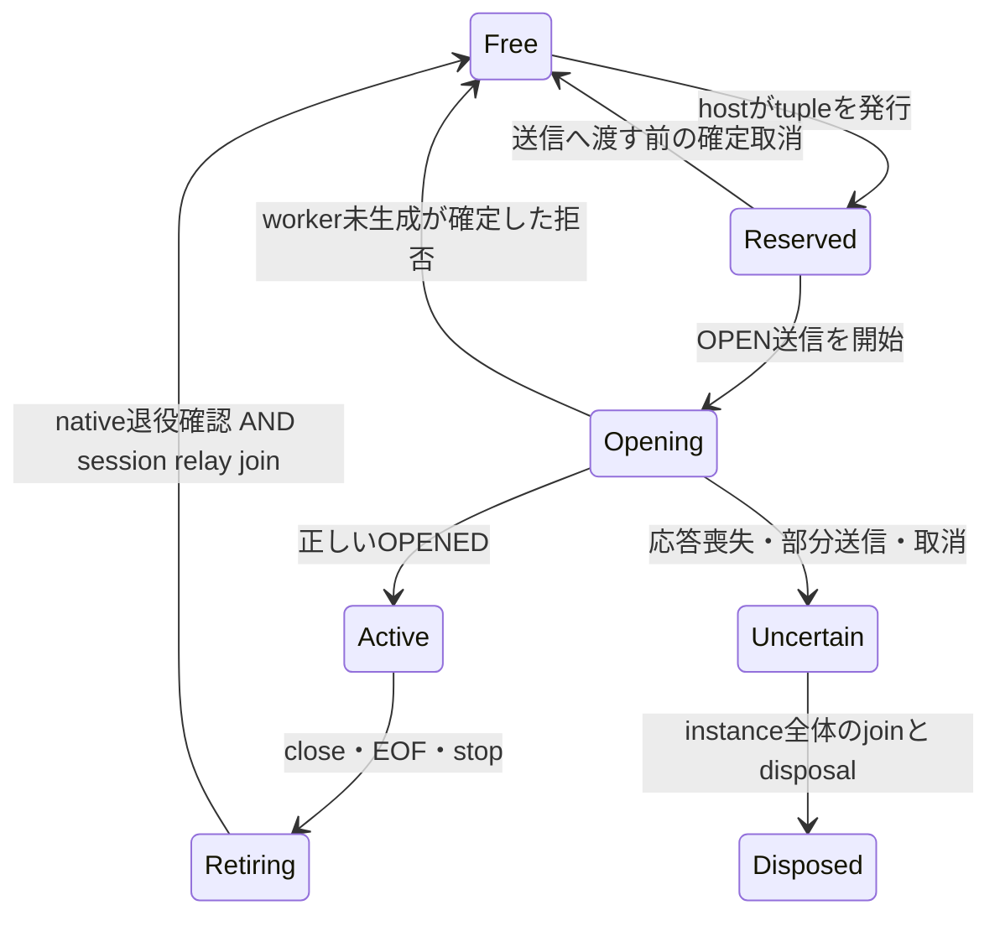

# Issue65 P1 — native経路の製品化計画

状態: **HumanがP1-aの実装を承認。macOS／Linuxの限定検証済み。P1-bもmacOS／Linuxの限定検証済み。P1-cはC2公開接続・基本consumerをMacで限定確認、C3は残件。main採用・release未承認。**

設計時点のartifactとreviewは`9f4977135941acff010987e49ff0cad9221b2734` /
`3f934997cd8ead4daf6a639c7fc75cbb1d863e06`に保持する。以下の完了条件をP1-aの実装・検証に適用する。
[実装とmacOS実測](../../../benchmarks/spikes/issue65-p1-owner/README.md)を保存した。
[CI42346396518](https://github.com/masahitojp/mariamem/actions/runs/42346396518)で
同一guest・287ファイル・G2全241観測のLinux照合が完了した。
[固定候補のreceipt](../../../benchmarks/spikes/issue65-p1-owner/evidence/ci42346396518.json)を保存。
完了範囲はP1-aであり、後続P1-b以降の完了・採用判断とは分ける。

承認したP1最初の実装範囲は、**hostによる接続枠とsession identityの所有** です。
設計時点ではhostの接続予約とC++のslot/generation発行が分かれていました。
二つの管理を一つのownerへ揃え、公開APIへ接続する前に所有権を明確にする方針です。
最大の懸念は、OPENの結果が不明なときや終了通知の直後に枠を再利用し、古いworkerやframeを
新接続へ結び付けることです。以下の保留規則と、枠解放の二条件を実装・検出条件にします。

## 設計時点で固定した根拠と範囲

- 調査base: `781fa29926be06856728741df96a1a4713e93af3`。
- 実行済み候補: `f3fe907ac238e738c94b684426e6230b23a3c163`。
- guest/checked host source: `76abfed4b5f920c79efd5fef33c848c21ac040c9`。
- UNQUALIFIED guest SHA256: `242f5cfd446ac65dc3d7322ead668cd2ec5473193cf4bb58b69c7c5b3cfe6e87`。
- [CI42338117054](https://github.com/masahitojp/mariamem/actions/runs/42338117054):
  LinuxでG2全241、G1全234、既存22 lifecycle/88互換性/38 limitsとsupporting checksがPASS。
  [保存receipt](../../../benchmarks/spikes/issue65-g2-repair/evidence/ci42338117054.json)は
  guest再現、283-file比較、承認済み契約でのMac241観測照合、cleanupを保持。
  Macの1043ケースは既存実測の契約再評価であり、更新fixtureを新しく実行したとは扱わない。
- [承認済み責務表](contracts.md#state-belongs-with-the-authority-that-can-make-it-true)と
  [D1–D3](../../decisions/issue65-native-wire-contract.md)を変更しない。
  4型のnative NULL動作とshort fixed-headerの1043/08S01も保持する。

以下のfile:lineは上記baseの行番号。既存CIのPASSは、これから変更するrouteのPASSではない。

## 現状の実装から分かったこと

| 現状 | 根拠 | 設計への帰結 |
| --- | --- | --- |
| C++が空きslotを選び、per-slot generationを増やしてOPENEDを返す | `guest/experimental.patch:1419` (`Manager::open`) | host予約とguest発行を一緒に移す。hostが選びguestが選び直す方式にしない |
| TCP/Pipeはhostの`reserved`を共有し、OPEN失敗時の不確実性を保持する | `benchmarks/spikes/issue65-compat-fixes/main.go.txt:279`,`:283`,`:497` | 新ownerに予約・identity・解放をまとめ、既存の保守的な失敗処理を維持 |
| OPENEDからhostのsession mapへidentityを取り込み、RETIREDで予約を返す | 同`:395`,`:437` | OPENEDを信用して新しいidentityを採用せず、予約済みtupleとの完全一致を検査する |
| guestのRETIRED発行は`worker.join()`後 | `guest/experimental.patch:1465` (`reapLoop`) | guest joinを残す。THD unregisterやtransport EOFを代用しない |
| foreign allocation-freeはworkerの最後のアクセス終了を待つ | `internal/generatedgo/code/base/thread_lifetime.go:46`,`:90`,`:113`、`thread_lifetime_test.go:40` | 既存completion/reclaimを再利用。C++ joinだけを独立したGo完了保証とは扱わない |
| WASIX joinがmap_baseを解放する経路は既存J1調査に記録済み | `docs/reviews/v050-boundary-join-fixes.md:82`、P6 `v06x-prepared-p6-canonical.md:100` | 新guestでbinding/closureを照合し、移設routeで遅延barrier試験を追加する。新しいper-session join APIは前提にしない |
| `WaitThreads`はrootのspawn停止後に使う全worker join | `internal/generatedgo/code/base/base.go:11645` | 稼働中の各session退役で呼ばない。共有reader/全体WaitGroupも同様 |
| 公開Startは`host.StartGenerated`と具体的な`Guest.Done()`へ接続し、legacy `mysqlwire.Serve`が動く | `mariamem.go:128`以降、`internal/host/server.go:169`以降 | 専用cmdが動くことと公開backend実装を区別する |

native join→foreign reclaim→host completion待機は既存コードを組み合わせた根拠である。
今回、新しいnative worker barrierの実行はしていない。新guestと移設routeでこの順序を壊す
negative controlを検出することをP1-aの完了条件にする。既存bindingの単体PASSだけで代用しない。
現在のnative supporting commandは `benchmarks/spikes/issue65-compat-fixes/runtime_tests.py:8` の
`TestWireCaptureWaitsForFailedWorkerPeer`に限定され、production index-bound testsを除外している。
baseのThreadLifetime testsが存在することを、この新guestで実行済みの証明にはしない。
P1-aでは対象guestのbindingに結び付けてleaf testsと実routeのbarrierを選択する。

## P1-a: 最初の境界 — 接続予約とidentity

### hostが所有するもの

instance epoch、16枠のlease、各slotのgeneration、OPEN要求との対応、sessionのhost relay終了。
TCP/Pipeで別々の上限やallocatorを持たない。Live frontend generation、session generation、
generated worker IDは別物として扱う。host ownerのlockで予約とClose/captureの受付停止を直列化する。
外部I/Oやjoinを待っている間、そのlockを保持しない。

private frameの33-byte headerは変えず、OPENの`epoch/slot/generation`をhostが指定する。
`request`はRPC相関、`value`はこの段階では既存timeout値のまま。READYの`lifecycle_profile`を
**2**にし、host/guestとも一致を必須にする。profile1との自動fallbackや混在対応は加えない。

- epochはinstanceごとに新規発行。Fork/Live Resetでは新ownerを作り、leaseやcounterをbaselineから継承しない。
- slotは0..15。generationはper-slotの単調増加uint64、0は無効。破棄した予約の番号も再使用しない。
- RPC request IDとepochもwrapして再使用しない。最大値到達後は飽和した失敗状態を維持する。
  現`atomic.Add`で一度0を検出するだけでは、次回に1へ戻れるため不十分（同main.go`:174`,`:313`）。
- slot generation/request exhaustionはinstanceを停止し、ownerに原因を残す。epochの発行不能はStartを失敗させる。
  境界試験はbinary frame/typed integerで行い、JSON float64の精度に依存しない。

### guestに残すもの

slotごとの実Session/THD、受理済みgenerationのwatermark、既存join/reaperとatomic SQL/capture gate。
guestは指定されたslotが空き、epoch一致、generationが非zeroかつそのslotのwatermarkより新しいことを
確かめる。slotを探したりgenerationを増やしたりしない。watermarkはリプレイ検査の派生状態であり、
別のidentity allocatorではない。拒否した要求でwatermarkを進めない。

OPENED/REJECTEDはrequestと要求slot/generationを対応させ、hostが一致を検査する。
応答envelopeのepochは稼働instanceのepoch。foreign-epoch要求への拒否を、新しいOPEN成功として採用しない。OPENED後のnative出力許可の
既存順序も残す。guest側のoccupied/invalid-slot拒否はhostとの不整合として扱い、通常の容量不足に
見せかけない。通常の17接続目はhostの予約時点で拒否し、既存の固定pre-login応答を再利用する。
SQL packetをhostが読む処理や、正常なgreeting/OK/ERR/rowの生成は加えない。

### leaseの状態と解放

`Free`への遷移でも次のgenerationは増やす。instanceが停止/failed/capturingなら新規予約は不可。
送信開始後の単なるerrorを「未送信」とみなさない。現在のprivate route同様、OPENの結果が不明なら
instanceを失敗させ、枠と資源をrootの完了まで保持する。public Dial取消の受理契約はP1-cで別途照合する。

解放は **native RETIREDに結び付く実worker完了** と **当該sessionのreader/writer relay終了** の両方を
満たしてから一度だけ行う。ここでnative worker完了とは、native joinと、foreign reclaimで待つ
最後のguest/linear-memoryアクセス終了を指す。RETIREDをinstance全体の`ThreadPool.WaitThreads`完了と
同一視しない。instanceのFS/linear-memory/backing解放は従来通りroot停止後の全worker joinとdisposalを
必要とし、session枠の再利用とは別条件で保持する。
native frameを読む共有readLoop内でrelay終了を待たず、session単位の完了処理へ
渡す。全instanceのreader/worker WaitGroupをsession joinに使わない。古い/重複RETIRED、CREDIT、OUTPUTは
完全なtupleで判別し、新generationの枠・byte accountingを変更できない。

失敗/CloseでRETIREDを受け取れなくても、root worker join・reader/relay joinとdisposal完了までは保持する。
完了しないworkerの強制回収は保証しない。既存のfirst cause、cleanup debt、capture debtを潰さない。

capture開始時は同じhost owner lockで受付を止め、`Reserved/Opening/Uncertain`があれば、guest fenceを
要求する前にbusy/failedとして戻す。既に送信中のOPENを、hostの見かけ上のidleで追い越さない。
これらが無い場合もhost状態はSnapshot許可ではなく、guestの最終SQL/capture fenceを必須にする。
Activeなidle sessionやRetiringの扱いを、hostのcounterだけで新しく緩和・拒否しない。sourceの消費と
FS/backing解放は従来のguest確認・全join条件に従う。

### P1-aに入れない変更

SQL admission、first-byte deadlineのguest atomic gate、timer scheduling、Vioのqueue/wakeup、
input/output credit上限、Snapshotの最終capture fence、native cancellation機構は維持する。
公開APIの切替、timeout範囲変更、canonical generated-Goの置換も同じ差分に混ぜない。

## 続くP1の順序

| 段階 | 変更する境界 | 完了の判断 |
| --- | --- | --- |
| P1-a（限定検証済み） | hostの予約/identity/退役所有とprivate profile2 | 下記検出条件＋移設routeの既存native検査が両OSで通る。CI42346396518で確認 |
| P1-b | 公開timeout設定を新経路で表現する | 既定30sと既存受理値を保存。100..10000msに丸めない。first-byte基準と古いcommand token拒否を維持。設定値・取消・overflowの試験と実経路確認 |
| P1-c | 専用cmdからprivate reusable backendへ抽出し、公開Go/PythonのStart/Dial/Snapshot/Fork/Liveへ接続 | owner Err/ErrUnusable/first cause/debt、Close/WaitDisconnected、正常接続、dial取消、fault処理を公開routeで確認。native routeを無効にするnegative controlが検査を落とす |
| P1-d | queue policy/輸送deadline/watchdogなど残るhost管理を境界ごとに移す | 総pending所有、blocked output、stale token、stop/captureの最終gateをそれぞれ検査。guest機構を消すだけでは完了しない |
| P1-e | production生成・検出CI・採用候補の整理 | 最新mainとの差を照合し、HANDWRITTEN_FILES/provenance/生成物所有とpublic CIを結び直す。実験patchをそのままmainへmergeしない |

timerの配置はP1-dで判断する。遅延したhost通知からSQL admissionを推測してguest watchdogを削らない。
P2は宣言driver/ORM等の実public native経路での受入れと同条件の性能比較。0.6.2との差にはengine/UCA等の
別要因を分ける。canonical採用とreleaseは後のHuman判断であり、この計画の承認に含めない。

## 検出条件 — 既存CIの限界と追加する検査

| 壊れ方 | 既存の検出 | P1-aで追加/結び直す検査 |
| --- | --- | --- |
| TCPとPipeが別枠になる、退役中に17接続目を許す | `TestCompatCapacity`、`TestCompatLiveCapacity`、`TestCaptureGoPipe`は基本動作を検査。二つの退役条件の遅延順序は未検出 | mixed TCP/Pipeで16枠。native側/host relay側を別々に止め、一方だけの完了では再予約できないこと |
| guestがhost指定slot/genを無視して自前発行 | 現CIはguest発行identityで動くため不可視 | 指定tupleの一致、profile1拒否。guestが指定を無視するmutationで実native試験が落ちること |
| 古いepoch/slot/genが新sessionを動かす | `TestQueryDeadlineAndIsolation`はforeign epochを検査 | slot再利用後の古いDATA/ACK/EOF/RETIRED/OPENEDとduplicate OPEN。新session/容量への影響ゼロ、拒否前後のSQL/PING |
| OPEN応答喪失でleaseを戻す | 現attachはlost OPENをfail扱い。named uncertain-OPEN専用oracleはない | OPEN受理後にOPENEDを落とし、native workerと予約がroot disposalまで保持されること。pre-send確定取消と区別 |
| native RETIREDを早期発行、最後のGoアクセス前に再利用 | `TestWorkerReclaimWaitsForLastAccess`等はleafのreclaimを検査。現capacity試験は完全な移設経路のbarrierではない | native join→foreign free→Go completionの経路にbarrier。早期RETIRED/早期host lease releaseのnegative controlsを拒否。新guestのbinding/closureを再照合 |
| identityのwrapで衝突 | ThreadPool ID用の`TestThreadIdentityConcurrentAllocationAndExhaustion`は別namespace | epoch/request/session generationそれぞれの最終値、次回/次々回も失敗、並行発行。resetして再使用しない |
| owner変更でcapture/Liveの順序を壊す | native14+Live8、`TestCaptureJoinCancellationRetainsLease`、`TestNativeLiveCapacityBeforeDrain`など | 既存22を新routeへ再使用。新規受付停止とOPEN競合、失敗/取消でlease/debtが残ること |
| 通常wire/SQLを壊す | G1 234、G2 241と88互換性/38 limits | profile2の新guest/host bundleで元のoraclesを再実行。1043契約の限定fixture変更だけを維持 |
| 専用cmdだけが通りpublic defaultやownerが未接続 | 現native CIには見えない | P1-cのpublic-route検査。ここをP1-a PASSで充足扱いにしない |

新guestのsource/worker bindingを確認してから実行する。最初は既存private byte/control seamで進め、
cgo/direct callbackやsysroot ABI変更を加えない。host ownerの決定的unit/fault試験を先に置き、次に新guestを
一度build・binding reviewし、macOS native＋Linux CIを各1 cohortで実行する計画。これは次の実装taskの
予算案であり、現時点の新実行やCI提出ではない。失敗時は同じartifactの闇雲な再実行ではなく、原因と残条件を記録する。

## 進める条件

P1-aのprivate profile2と上記完了条件を実装対象として確定してからruntimeを変更する。
合格した場合にP1-bへ進む。根拠のある退役barrierを作れなければ枠を早く解放する妥協はせず、
既存completion seamに不足する観測だけを限定して追加する。そこでSQL/transport全体の作り直しへ広げない。

## P1-b実装・macOS確認、Linux照合待ち

Humanの継続依頼により、[P1-b](../../../benchmarks/spikes/issue65-p1-timeout/README.md)を実装した。
Go Optionsの0/default30sと正のtime.Duration全域をprivate profile3で正確なnanosecondsとして運ぶ。
旧profile2のmillisecondsとは混在せず、33-byte headerは維持する。guestは1..MaxInt64を検査し、
期限の加算をunsigned elapsed ticks比較へ置換した。first-byte admission、timer配置、5ms poll、
SQL/capture gateとnative cancellationの権限は変えない。既存fixtureのmillisecondsは検査付きで変換する。

Macでは専用8試験・実経路負例3、actual public Options比較と既存P1-a/G1/G2がPASS。
最大durationの実時間待機は主張せず、設定値のtyped/string観測・直後のSQL・境界算術を組み合わせる。
291-file sourceと全241観測のLinux照合を残す。公開backend接続・Go/Python制御APIへの再bind、
Fork/LiveのOptions継承はP1-cで確認し、このprivate routeのPASSだけで公開統合済みとは扱わない。

## P1-c公開backendの具体化

Humanの継続依頼を[公開backend計画](public-backend.md)と
[source review](../../reviews/issue65-p1-public-backend-plan.md)へ具体化した。
Go/control/Pythonの既存ownerへ接続し、Snapshot/Fork/Live・typed disposal・設定継承までを
P1-cの範囲とする。現在は設計/source照合のみ。P1-b成功は未確認で、実行開始の前提に残す。

## P1-b成功確認とP1-c C1抽出候補

[CI42353912021成功receipt](../../../benchmarks/spikes/issue65-p1-timeout/evidence/ci42353912021.json)で
P1-bのLinux guest再現・291-file/241観測照合を確認した。上の「Linux待ち」は実装時の記録。
Humanの継続依頼により[C1共通core](../../../benchmarks/spikes/issue65-p1-core/README.md)を抽出し、
fake-runner/raceと5負例で単体確認した。公開factoryと専用cmdは未切替で、実nativeでの再検証も未実施。
C2公開Go/Python接続→C3 Snapshot/Fork/Live・設定・失敗契約・両OS受入れが残る。
既存証跡6ファイルによるpublic-source検査FAILは別記し、公開可能性PASSとはしていない。

## P1-c C2公開接続のMac確認

[実装と固定証跡](../../../benchmarks/spikes/issue65-p1-public/README.md)。
公開Go TCP/Pipe、installed Pythonの通常start/shared-control、standalone hostがnative coreへ到達した。
同じguest/runtimeを使い、native factory無効化でGo/Pythonの検査が失敗する。既存公開consumerで
Snapshot/Fork/Liveの基本経路も確認した。C2の結果は固定UNQUALIFIED artifactのMac限定。
C3のprecise duration継承、実failure/永久debt・元oracles再bind・Linuxは未完了で、
P1-c全体・main採用・性能・releaseを完了扱いにしない。canonical factory/guestは据え置く。
