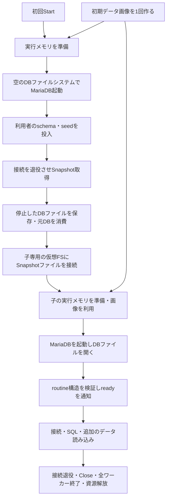

# 起動・Snapshot・Forkの処理と計測の読み方

この文書は、mariamemの起動処理を追うための見取り図です。2026-11-14のmainでは
静的な初期メモリ画像の共有が採用済みで、公開済みv0.6.2には含まれません。
[所有権の決定](../decisions/process-static-image-cache.md)と
[採用後の計測・Close診断](../reviews/issue123-postmerge-measurement.md)を参照してください。
後半の数値は2026-11-07時点の試作の観測であり、現行mainの計測ではありません。

## まず区別する3種類の状態

| 状態 | 中身 | 再利用の単位 |
|---|---|---|
| プログラムの初期メモリ画像（main採用済み） | MariaDBの生成コードが配置する初期データ | プロセスで1回作成し、各DBへprivate CoWで配置 |
| アプリのSnapshot | schema・seedを準備し、停止して保存したDBファイル | 同じbaselineから複数の子へ、書き込みを分離して利用 |
| 起動後の実行状態 | InnoDB内部構造、バッファ、ロック、スレッド、接続 | 各子で作り直す |

初期メモリ画像はアプリのSnapshotから作るものではありません。最初のDBを
起動する際、MariaDB本体を動かす前の初期データから作ります。起動済みの
InnoDBを保存したメモリ画像でもありません。

## 全体の流れ



GoのSnapshotは成功時に元DBを消費します。受理後の失敗でも消費される場合が
あり、事前条件の拒否とは区別します。子の書き込みはbaselineや兄弟へ漏らしません。

## ForkでSnapshotのデータを使う場所

1. 容量枠を取得し、Snapshotの所有者・guest識別を確認します。
2. 子の仮想ファイルシステムを作り、保存済みのDBファイルを`/mariadb`へ接続します。
   現行の通常root経路では、ファイルのブロックを参照する子専用ビューを作ります。
   毎回DBファイル全体をコピーしているわけではありません。
3. 子の実行メモリとModuleを準備します。mainでは初期値のあるページを
   プロセス内で共有する画像からprivate CoWで配置し、残りを匿名メモリにします。
4. MariaDBを実行します。ここでDBファイルを開き、必要な内容を読み、実行用の
   状態を構築します。保存済みファイルを接続する工程と、その内容をMariaDBが
   読む工程は別です。
5. 内部bootstrap接続、routine関連の準備・検証を経てreadyを通知します。
   ready後の接続やSQLでも必要なデータを追加で読みます。

復元済みDBの`mysql.proc`構造は検証します。不整合を黙って修復する経路ではありません。
Freshでは構造を作成して検証し、Forkでは保存済み構造を検証します。

## サーバー初期化の中

```text
実行メモリ・Moduleの準備       ← 静的ページ共有が直接短縮する箇所
  ↓
mysql_server_init
  共通初期化（変数・文字コード・照合順序の登録など）
  MyISAM等の準備
  プラグイン起動
    InnoDB（バッファ、既存ファイル、復旧、内部構造、背景処理）
    Aria、認証、その他
  残りのサーバー初期化
  ↓
内部接続・test DB・routine準備
  ↓
ready
```

以前の細分化診断の**平均値**です。観測ありの別実行なので、直近の診断約28msへ
これらをそのまま当てはめたり、現行値として再ラベルしてはいけません。

| サーバー初期化の工程 | P1 | P4 |
|---|---:|---:|
| 共通初期化 | 7.96ms | 9.45ms |
| プラグイン起動前（主にMyISAMキーキャッシュ） | 1.31ms | 1.85ms |
| InnoDB | 9.56ms | 13.70ms |
| Aria | 1.65ms | 3.38ms |
| 認証 | 0.64ms | 1.25ms |
| その他プラグイン | 1.00ms | 1.56ms |
| 起動後の準備・その他 | 1.07ms | 1.79ms |
| **合計** | **23.19ms** | **32.98ms** |

InnoDB内では、既存ファイルのオープン・復旧・内部状態構築が約6.54/8.70ms、
バッファプール作成が約1.36/2.47msでした。前者には読み込み以外の検証や構築も
含まれ、全部が物理I/Oやコピー時間ではありません。P1で捕捉できた読み取り
呼び出しの合計約0.56msも完全なI/O計測ではなく、差をCPU時間とは呼べません。

## pgmemのFreshとForkから分かること

比較に使ったpgmem v1.18.2（a61005d3）では、Freshは共有ファイルと事前生成済み
DBアーカイブを展開し、必要ならユーザー・DBを準備し、展開用バッファの回収を
明示的に行ってから起動します。毎回initdbを実行する経路ではありません。
ForkはSnapshotのファイルシステムをCloneして共通のサーバー起動処理へ入ります。

pgmemも子ごとにPostgreSQLを起動します。静的メモリ画像の共有経路はありますが、
確認したFactoryは起動済みPostgreSQL全体のメモリを複製する経路ではありません。
また、接続バックエンド側の初期化はFork後の接続時にも発生します。
比較にはFork単体と「同じSQLを実行できた時点」の両方が必要です。

## 数値を読む際の境界

- `Start/Fork → ready`は、schema・seedまで同じ状態に到達した時間とは限りません。
  Fresh側のmigration/seed費用と、Fork側のbaseline準備費用を別に記録します。
- 初回画像作成はプロセスで1回の費用です。Freshだけ初回、Forkだけwarmという
  比較に混ぜず、初回と再利用時を区別します。
- P4は子4個の実行です。通常ループではSQL待ちが後続Forkの重なり方を変えます。
  固定wave実験は「4個全てready後にSQL、全Close後に次の4個」として切り分けました。
- 観測付き実行は、ログ・カウンタの費用とスケジューリングの変化を含みます。
  工程の診断値を通常実行の性能値へ読み替えません。
- 平均は同じ子の重複しない区間なら積み上げ可能です。独立に求めた中央値は足せません。
  server_initの内側にあるInnoDBを、server_initに再加算しないでください。
- 経過時間、プロセスCPU、仮想メモリ、RSSは別の量です。RSSは共有物理ページの
  精密な内訳を示すPSSではありません。
- ready後の約800ms SQL待ちと起動時間は別です。待ちを除外して合格へ変えたり、
  別実行の所有者ログから原因を割り当てたりしません。

## 2026-11-07の試作でFreshとForkを同じ状態まで測った結果

静的ページ試作を有効にした同一バイナリで、P1/P4・各3ペアを比較しました。
両方とも最初に同じbaselineを準備して画像をwarmにし、Freshの子は空DBから
同じschemaと1,000行のseedを作成、Forkの子は保存済みbaselineから開始しました。
これは初回費用をそろえる比較用の設定で、通常のFreshがSnapshotを作るという
意味ではありません。子のAPI開始からCOUNT/SUMで同じデータを検証した時点を
「同じデータの検証完了」としています。P4は固定waveです。

| 通常計測・中央値 | Fresh | Fork |
|---|---:|---:|
| P1 API起動 | 22.07ms | 25.18ms |
| P1 同じデータの検証完了 | 30.38ms | 27.50ms |
| P4 API起動 | 25.58ms | 32.54ms |
| P4 同じデータの検証完了 | 41.17ms | 38.36ms |

3プロセスそれぞれの子中央値を求め、その中央値を表示しています。同じデータの
検証まで含めると、ForkはP1/P4とも3/3ペアで短縮しました。Fork側P4に約816msの
COUNT待ちが1件あり、平均やスイート全体時間はその影響も含みます。除外していません。

| 詳細診断・平均 | P1 Fresh → Fork | P4 Fresh → Fork |
|---|---:|---:|
| 共通初期化 | 8.34 → 8.43ms | 9.26 → 9.01ms |
| InnoDB全体 | 5.58 → 9.43ms | 6.84 → 11.19ms |
| ↳ 表領域作成／既存ファイルopen・復旧 | 0.71 → 6.52ms | 0.83 → 7.22ms |
| ↳ 後続のtransaction関連区間 | 2.01 → 0.14ms | 2.27 → 0.14ms |
| ↳ バッファプール | 1.30 → 1.31ms | 1.74 → 1.69ms |
| サーバー初期化全体 | 20.00 → 23.81ms | 24.34 → 29.33ms |
| routine構造の作成／検証 | 1.67 → 0.97ms | 2.04 → 1.28ms |

内側の行は上位区間に含まれるため再加算できません。この「作成／open・復旧」は
同じ計測境界で、新規DBと既存DBの別ルートを含みます。単なるread時間ではありません。
その区間のFork追加時間は、P1の3ペアで+5.86/+5.77/+5.78ms、P4で
+6.57/+6.32/+6.26msでした。一方、後続のtransaction関連区間はFresh側の方が
長く、上記差の一部を相殺します。

**共通初期化は両方に残る大きな費用ですが、今回のFresh/Fork差の中心では
ありません。** 次に差の原因を追うなら、InnoDBの既存ファイル・復旧区間の中で
何を読んで何を構築しているかが対象です。復旧や検証を省く変更を意味しません。

観測の有効化でAPI起動中央値が約1.4〜3.8ms変わりました。詳細診断は工程の比較に
使い、通常計測へ一定値を足し引きしません。DBの大小・schema・seedに依存する
結果であり、すべてのアプリやpgmemとの新しい速度比較を主張しません。

[今回の全ペア・計測条件・再集計用データ](https://github.com/masahitojp/mariamem/tree/67b88dc4d5d1b997c43568769f90551091a09fc2/benchmarks/freshforkstartup/results)

## これまでの結果と参照先

| 証拠 | 分かったこと | 限界 |
|---|---|---|
| 詳細初期化診断 #121 | 共通初期化とInnoDBの内訳 | 静的ページ共有前・観測あり |
| 全領域画像の試作 #123 | Module準備は短縮、以後の起動費用が増加 | 採用見送り、ページフォルト原因は未確定 |
| 静的ページ限定の試作 #123 | P1 Fork約4.2%短縮、保持RSS約5〜8%減 | 通常ループP4は短縮条件未達、初回Start増加 |
| 固定P4 wave #123 | Fork約4.3%、4-ready約4.6%短縮、5/5改善 | 通常ループの結果を上書きせず、CPUはほぼ横ばい |

- [細分化した初期化診断](https://github.com/masahitojp/mariamem/blob/7fd1a7a9/benchmarks/postucainit/results/README.md)
- [静的ページ限定の計測](https://github.com/masahitojp/mariamem/blob/a16502e3/benchmarks/staticimagepages/results/README.md)
- [固定P4 waveの計測](https://github.com/masahitojp/mariamem/blob/1c244713/benchmarks/staticimagewaves/results/README.md)
- [Issue #123・採用までの記録](https://github.com/masahitojp/mariamem/issues/123)
- [Go Snapshotの契約](../go.md)
- [pgmem Fresh](https://github.com/shibukawa/pgmem/blob/a61005d37d01e6671f814fe8ca828222e8147df4/pgmem.go#L98)
- [pgmem Fork](https://github.com/shibukawa/pgmem/blob/a61005d37d01e6671f814fe8ca828222e8147df4/snapshot.go#L73)

次の改善を考えるときは、「プロセスで共通」「Snapshotごとに共通」「子ごとに必要」
のどれを動かすかを先に決めます。初期化済みエンジン全体の保存や、背景処理を
残した早期Closeは別の設計判断です。
