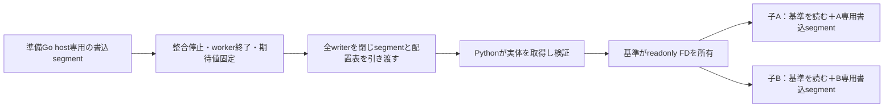

# DのSnapshot設計：heapから転送する案／最初から共有領域を使う案

2026-10-16。設計比較のみ。実装・追加測定は行っていない。

後続：Human承認後の[D1・D2部品spike結果](d-snapshot-components.md)を保存。
以下は実装前の設計・承認対象を記録したもの。

## Human Review

**次に判断したいのは、D1・D2の共通の所有形式と受け渡しを、小さな部品spikeで比較するかです。**
推薦は両案を同じ取得・隔離・解放条件で比較すること。HumanはOS間の性能差への懸念から
Dの具体化を選択しました。E優先という[前回の推薦](snapshot-ownership-design.md)から、
検討の優先順位を変更します。Eの既存結果を否定したという意味ではありません。

決め手は、Dなら変更時のコピーと確保の単位をライブラリ側で揃えられる一方、
**最初のSnapshotで内容を転送するか、準備中から共有領域を使うかで費用が変わる**ことです。
ここを分けず「DはOS非依存で速い」とは評価できません。

最も強い反論は、D1では初回Snapshotの転送が残り、D2では共有領域へのOS依存が残ることです。
したがってDの設計だけで、Eより速い・環境差が小さいとは推薦しません。
共通部分と差分を切り分けた有限の比較には価値がありますが、製品採用はまだ判断しません。
本資料はその比較対象を具体化したものです。部品spikeは未実施・次の承認対象です。

## 対象と既存証拠

中心はユーザーの通常例です。

```python
with mariamem.start() as setup_db:
    migrate_and_seed(setup_db)
    with setup_db.snapshot() as baseline:
        with baseline.fork() as first:
            test_create(first)
        with baseline.fork() as second:
            test_update(second)
```

最初の基準作成、子2個の起動・小変更・終了、基準の解放までを対象にします。
派生Snapshotは追加の利益と寿命を評価する境界であり、通常例を置き換えません。
[製品契約](../decisions/snapshot-product-contract.md)の実DB、独立したcommit/rollback、
成功時の元DB消費、事前拒否時の継続利用、基準Close後の開始済み子の生存を守ります。
一時形式を変えても公開APIやユーザー管理daemonを要求しません。

[前回D＋E][d-report]で確認できたのは子I/Oのブロック化です。
全体時間の明確な改善なし、子Go累積割当約73%減、最大RSS減少なし。
準備DBとSnapshotはEを使用し、D独自Snapshotは実装していません。
その結果をD1/D2の性能値として再利用しません。

| コードで確認したもの | 再利用候補 | 新たに必要なもの |
| --- | --- | --- |
| [dStorage][block]：16 KiB heapブロック＋連続した不変backing、read/write/resize | 部分更新、全block上書き時の元read省略、EOF、shrink/regrowの考え方とfixture | backingをblock参照へ一般化。16 KiBは前回の試作値で最適値ではない |
| [接続部分][integration]：`DEnable(child)`は子だけ有効 | node/FD identityとFS lockを維持する方針 | Fresh準備にも接続、freeze・所有移転、参照の最早解放 |
| [overlay][overlay]：子の元fileはreadonly mapping、変更はheap | 読み取り専用基準＋独立変更という分離 | packing/arena allocator、世代、構成metadata、host間受渡し |
| [Python Snapshot][python]／[Go Owned][owned]：取得時全検証、Fork時FD継承 | 借用中のClose同期、受信後の所有、失敗時Close | block形式は現行のfile形式protocolにそのまま渡せない。別の内部decoderが必要 |

## 共通の一時形式：実体と「どこを読むか」を分ける

以下は提案する内部形式です。現行の保存形式を変更する決定ではありません。

- **基準root**：guest identity、directory/file inventory、各fileの論理EOFと期待content hash。
- **配置表**：file内の範囲→不変segmentのID・offset・長さ、またはzero領域。
  範囲のoverflow、重複・欠落、不正な参照、EOF外を拒否する。
- **segment実体**：複数blockをまとめて保持する読み取り専用backing。
  一block一FDにせず、FD数をblock数に比例させない。
- **子の状態**：独立したfile構成、親の不変範囲、子専用の変更blockと新規file。
  親のGo mapやsliceをそのまま別プロセスへ渡すものではない。

zeroは「過去に書いた内容を無視してよい」という意味ではありません。
拡張やtruncateの規則によりzeroであることが分かる範囲だけを表現します。
完全性検証は論理file内容（zeroを含む）を元期待値と照合し、形式変更を理由に省きません。
将来のblock単位の検証再利用は今回の二案の利益に算入しません。

## D1：更新はheap、停止後に共有用segmentへ転送


準備中のblockはそのGo hostだけが所有します。停止後、Snapshot対象fileの保持すべき
blockをsegmentへまとめます。未変更親blockのない**初回基準では、保持する内容の転送が必要**です。
論理的な未使用zero領域を省けても、migration後の実データまで無料で移せるわけではありません。

転送後、writerを閉じ、Pythonがreadonly実体を取得して私有pathを削除し、
保持する実体と配置表から論理内容を検証します。成功時だけSnapshotを返します。
二つの子はそのsegmentを読み、自分の変更をheapに持ちます。
読み出しの手段はreadonly mappingと位置指定readを切替可能な境界にします。
この選択も性能に関わるため、Dのblock管理そのものと区別します。

## D2：準備中から、そのDB専用の共有可能なsegmentに置く



準備時のwrite先を、後で共有できるbackingのslotにします。
停止後に内容を詰め直さず引き渡せれば、Snapshotのpayload転送を省ける可能性があります。
**不変基準と生きた子の書込blockを同じ書込可能なsegmentへ混在させない**構成にします。
基準世代ごと、子ごとに書込所有を分け、他の子が変更できない状態を作ります。
ここでのwriter終了は、全workerと書込可能なFD・mappingの終了を指します。
pathのchmodやinode一致だけで、書込権がなくなったとは判断しません。

空きslotや大きな予約を持つsegmentをそのまま渡すと、使わない領域も寿命が延びます。
小さなsegmentへ分割するとFD・mapping・metadata管理が増え、詰め直すとcopyが復活します。
このためD2は「無条件でコピーもメモリ費用もない方式」ではありません。
容量上限と回収単位はallocatorの設計項目として残します。

## 通常の2子workflowでの所有とデータ移動

| 段階 | D1 | D2 | 共通の条件 |
| --- | --- | --- | --- |
| Fresh・migration/seed | setup hostがheap blockを確保・更新 | setup host専用segmentにblockを確保・更新 | 新規・予約・truncateも独立FSの規則を維持。準備時間を比較に含める |
| Snapshot事前確認 | まだ元DBが所有 | 同左 | transaction等で拒否なら元DBを利用可能のまま返す |
| 整合停止・freeze | heapと構成を固定、期待値生成 | segmentと構成を固定、期待値生成 | 全worker終了。任意のlive file一覧をDBのSnapshotとみなさず、既存exportとの内容・対象fileの一致を確認する |
| 引き渡し | 保持する内容を私有segmentへcopy | 全writerを閉じ同じsegmentを移管 | 元期待値を保持。pathはライブラリ内stagingで、保存済み公開物として扱わない |
| 所有取得 | Pythonが取得して内容・構成を検証 | 同左 | 実体化量と論理file長を区別。成功前に子へ公開しない |
| 子AをFork | 基準FD継承＋独立metadata、heap変更分 | 基準FD継承＋独立metadata、A専用segment | 新MariaDB runtimeの起動は残る。全量hashはForkごとに繰り返さない |
| 子AのCRUD・Close | heap変更分を使い、終了後回収 | Aのsegmentを使い、終了後回収 | 元基準の変更なし。終了時のDB内部writeも費用に含める |
| 子BのFork・CRUD・Close | 同じ基準＋B自身の変更分 | 同じ基準＋B専用segment | Aの変更を引き継がない。Bの開始前にAの後片付けが完了した通常例を中心とする |
| 基準Close | Python所有のFDと構成を解放 | 同左 | 受付済みForkとの同期後に解放。既に開始した子の独立寿命も別の境界として維持 |

Python→子のFD継承は既存の仕組みを利用できますが、渡す配置表とreaderは新設です。
Go APIではPythonに相当する基準ownerをGo側が持ちます。
どちらも準備runtime終了時のcleanupが、移管済みbackingを回収しない責任分離が必要です。

## 派生基準と保存：通常例に追加する境界

子Aから基準Qを作る場合、Qの配置表は親の未変更範囲＋Aの確定した変更範囲になります。
D1では変更分をsegmentへcopy、D2ではAのsegmentを凍結して引き継ぎます。
いずれも新しいfile構成・論理内容を検証します。前回観測した約48 KiBの基準コピー量は
子I/Oの値であり、この派生転送量の予測ではありません。

Qは参照する親segmentの保持権を独立して取得し、元の基準Pを閉じても使えるようにします。
原案は祖先rootを鎖状にたどらずQの配置表で直接参照する方式です。
参照解決は簡単になる一方、配置表の作成・複製は残ります。
segmentの一部が必要なら全segmentを保持する費用も残り、圧縮・再配置を無料とみなしません。

`snapshot_to(path)`は論理fileを既存の保存形式へ出力し検証します。
`load_snapshot(path)`は外部変更に影響されない内部実体を取得し検証します。
一時形式との変換費用が生じ得ますが、保存契約と破損拒否を維持します。
保存を使わない通常例のために、保存と同じpayload書き出しを必須にはしない方向です。

## OS依存について、何を変えられるか

| 性質 | Dで共通化する部分 | 残る依存・未確認 |
| --- | --- | --- |
| 小変更時の独立化 | blockサイズ、部分copy、全block上書き、zero/EOFをGo側の規則にする | blockがOS pageと一致するとは限らない。物理copy量・RSSを論理copy量から推定しない |
| 不変基準の読出し | 同じ配置表と内容を読む | readonly mappingならpage fault/cache、readならsyscallとbufferの費用。両OSの時間は未確認 |
| D1の更新 | heapのblock更新に揃える | Go allocator/GC、CPU/cache、Snapshot時の出力とOS I/O |
| D2の更新 | allocation/dirty範囲を自前管理 | writable backingの確保・mapping・page処理。E同様の共有backing依存が残る |
| 所有・破棄 | writer終了→取得→検証→子の借用という状態遷移 | FD・unlink・プロセス終了の実装と失敗時挙動を対象OSで確認する必要 |

OS任せの書込CoWは両D案で不要にできる設計ですが、OSのメモリ管理・I/Oを不要にはできません。
macOSとUbuntuで同じ論理コピー量でも時間が同じとは限りません。
Eで他OSの性能が悪いという証拠も、Dが環境差を解消した証拠も現在はありません。
本資料の分析は固定ソースと提案の責任分界によるもので、新たなOS APIの動作保証ではありません。

## 失敗時の所有権と、比較を成立させる条件

内部状態を `mutable → frozen → offered → acquired → closed` とします。
事前拒否以外は元DB復活を約束しません。途中失敗で使用可能なSnapshotを返しません。
staging責任者は呼出し側ownerに固定し、producerが途中終了しても回収対象を追跡できます。
receiverの検証完了を、公開API成功の境界とします。

| 失敗・競合 | 必要な結果 |
| --- | --- |
| 元期待値固定後の同size破損、配置の入替え、欠落/余分file、guest不一致 | 実際に所有する内容と構成を照合して拒否。期待値を実際のhashで置換しない |
| D1のcopy途中／D2のwriter Close・引渡し途中 | 元DBは終了済みと報告、候補を回収。部分成功の基準を公開しない |
| receiverのopen・検証途中、producerの異常終了 | 開いたFD・未取得stagingを回収。既存の親基準は維持 |
| 親CloseとFork、Q取得と親Close | 借用・参照保持が完了したものだけ継続。解放済み実体へアクセスしない |
| 子のtruncate/regrow、同fileの複数FD、rename/unlink | zero、node identity、既存lockの規則を維持。古い親blockを再露出しない |

既存の破損・隔離・lifetime oracleを残します。
内容走査数を一方だけ減らした比較を、Dの保存表現の効果とは呼びません。
元論理内容の期待値生成とreceiverの全検証を両案で同じ条件にします。

## 次の部品spikeを選ぶ場合の有限な範囲

推薦する最小単位は、**共通の配置表・owner・readerに、D1のpackとD2のfreezeを接続する比較**です。
まずMariaDB全体へ接続せず、実験専用producer→Python owner→二つのconsumerという
実際のプロセス境界で、決定的なfile内容と小変更を扱います。
これは性能採用の判断ではなく、所有形式が成立するかを安く確認する段階です。

終了時は次の4点をそれぞれ成立／不成立／未実施で報告します。

1. 初回Snapshot→2子の小変更で、内容・EOF・兄弟隔離が連続fileモデルと一致する。
2. 親Close後の子、派生Q取得後の親Close、途中失敗で所有が成立し資源を回収できる。
3. 元期待値固定後の破損と配置異常を、receiverが検出する。
4. D1/D2のpayload copy量、materialized量、segment/FD数、検査対象量を区別して記録できる。

一案が不成立なら具体的な原因を残し、代替を完成扱いしません。
macOSのみ実行できた場合、UbuntuはSKIPとして環境差の問いを残します。
部品試験の時間を利用者のテスト全体の短縮としません。
次の実guest接続では本資料の通常2子workflow全体と既存export一致の確認が必要です。
今回、その追加実装や実験を開始する承認までは得たと扱っていません。

## 今回の完了範囲と入力

D1/D2の通常workflow、データ移動、所有・検証・解放、派生・保存境界、OS依存を
既存コードと照合して具体化しました。設計比較は完了、実装成立・性能・他OSは未確認です。
資料の参照先・文言・diff/statusを確認し、変更していないruntimeのtest/buildは実施しません。

- runtime baseline `source_commit`: `a8137b8b444f86068d3128a291e3a848adfdfd56`。
- 前回設計 `source_commit`: `5a73a9fc725c5decfc8834d9c829062ca41493be`。
- D試作 `source_commit`: `c1875fa9e68d8588514cc1380d0ed3dc7d64409f`。
- 既存のmain上の未commit資料3件は変更せず、専用branchに文書だけ保存する。
  本資料の方向選択は製品採用の決定ではないため、mainの製品契約は変更しない。

[d-report]: https://github.com/masahitojp/mariamem/blob/c1875fa9e68d8588514cc1380d0ed3dc7d64409f/docs/reviews/d-block-cow-spike.md
[block]: https://github.com/masahitojp/mariamem/blob/c1875fa9e68d8588514cc1380d0ed3dc7d64409f/benchmarks/spikes/d-block-cow/block.go.txt
[integration]: https://github.com/masahitojp/mariamem/blob/c1875fa9e68d8588514cc1380d0ed3dc7d64409f/benchmarks/spikes/d-block-cow/integration.go.txt
[overlay]: https://github.com/masahitojp/mariamem/blob/c1875fa9e68d8588514cc1380d0ed3dc7d64409f/benchmarks/spikes/d-block-cow/instrument.py
[python]: https://github.com/masahitojp/mariamem/blob/a8137b8b444f86068d3128a291e3a848adfdfd56/python/mariamem/snapshot.py
[owned]: https://github.com/masahitojp/mariamem/blob/a8137b8b444f86068d3128a291e3a848adfdfd56/internal/snapshot/owned.go
