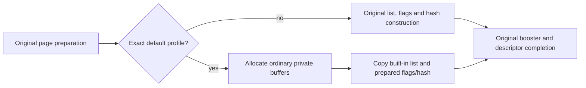

# Issue154: default UCA data reuse boundary

2026-11-11, source audit after the timer's main adoption.

**Recommendation: prototype prepared contraction flags/hash tables, copied into
ordinary per-DB allocations, and bulk-copy the existing built-in contraction
list.** Keep page preparation and all descriptors on their original path.
This removes construction work without introducing shared mutable runtime state
or relocating a captured guest heap. It is a bounded guest-source preparation
change, not a Go API or Fork/Snapshot format change.

The strongest objection is the small opportunity: all selected UCA work was
about 2.21 ms per Fork with observation enabled. Static input growth and copy
cost may erase enough benefit to make this unworthy of maintenance. Therefore
stop after one correctness-first prototype and an observer-off comparison if
there is no useful Fork/complete-suite benefit. No product change is adopted
by this design, and no improvement is measured here.

## What is established

The [previous observation](../../../benchmarks/uca-default-init/README.md) is
bound to runtime source_commit `500020e7dc6d702ef059f0e73a4bab738103b774`;
its compact report is at `ff468f024c9af68be0ac51ce2440a8c0447b26f2`.
This audit uses MariaDB `83e909fc2a0dbc394b4b683fb3fa2d7dcf26cc5e` and the
same canonical patch. [Source identities and definition anchors](source-audit.json)
record nine files, hashes and inspected producer/reader/allocator definitions.
There was no guest build, runtime experiment, heavy CI or new timing measurement.

`MY_CONTRACTION` has only six code points, seventeen 16-bit weights and a context
flag: no embedded pointer. Its WASM32 size in the observed generated code is
60 bytes. `MY_CONTRACTIONS` and `MY_UCA_CONTRACTION_HASH`, in contrast, hold
pointers and counts. This distinction allows data copying while keeping owners
private; the proposal does not copy their pointer values between DBs.

The default definition uses an **empty, non-NULL tailoring string**. It is not
safe to select this case with `cs->tailoring == NULL`: `create_tailoring` treats
NULL as an early-return path. The parsed-rule count and original source identity
must be checked, not inferred from the human-readable collation name.

## Ownership and writes

| Object | Construction/writes found | SQL use and lifetime | First prototype |
| --- | --- | --- | --- |
| Contraction list elements | `my_uca_add_contraction` appends characters/context; `my_uca_init_one_contraction` returns weights filled by rules or built-in copy | Readers return const elements/weights, including previous-context lookup; loader owns allocation | Bulk-copy existing built-in array only with zero parsed rules; retain private item allocation/count |
| 4096-byte contraction flags | Zeroed by allocation; `my_uca_add_contraction_flag` ORs head/middle/tail/context bits | Scanner checks bit flags | Prepared byte array copied into private flags allocation |
| 4096-cell contraction hash | Allocate/zero, then `my_uca_contraction_hash_populate` copies items into hash/probe positions | Hash lookup returns const entry; scanner updates its own state | Prepared numeric array copied into private hash allocation/count |
| Page lengths and page-pointer vector | `init_weight_level` copies vectors; marks rule-modified pages; page helpers allocate/copy; rules change weights | Readers dereference per-level vectors; unmodified pages already point at source weights | Original allocation/copy/generation and pointers, unchanged |
| `MY_UCA_INFO` / level structs / `my_uca1400_info_tailored` | Logical fields copied, levels zeroed and initialized; per-encoding/tailoring cache checks `level[0].weights` | Shared among compatible collations **inside one guest** | Original per-guest objects and initialization path |
| `CHARSET_INFO`, ready bit, handlers, casefold, strength and statistics | `create_tailoring`, definition init and `get_internal_charset`; ready published after successful init under charset lock | Mutable per-guest runtime state | Entirely original path |
| Existing prepared booster | Canonical source patch already chooses pinned default utf8mb3/utf8mb4 table; other cases populate normally | Const table pointer | Existing behavior and full-table verification retained |
| Allocation owner | Loader's `once_alloc` maps to `my_once_alloc`; arena blocks released by `my_once_free` | Arena allocation, not individual contraction-item free | Same allocator/lifetime; no new host cache or Close behavior |

Inspection includes `ctype-uca.c`, scanner/handler inline files, `ctype-uca1400.c`,
`m_ctype.h`, charset initialization and once allocator. No post-initialization
writes into contraction payload were found in those readers. This is **not a
whole-program alias/immutability proof**. Private copying deliberately avoids
requiring that stronger claim: later writes still belong only to the receiving
DB. It also avoids assuming two children have identical guest addresses.

The existing cache key is encoding plus tailoring, shared by PAD/NOPAD,
case/accent variants and some MySQL aliases. Consequently, exact-ID selection
alone is not an isolation proof: other variants can later consume a table first
initialized by an allowed ID. Conversely an alias/variant can initialize it first,
in which case the original initialization must remain valid and the optimization
may not execute. Exercise both orders; do not change cache keys or readiness.

## Proposed smallest path

Insert one guarded alternative in `init_weight_level` after the existing page
preparation, replacing only the contraction allocation/construction/hash block.
Parsing, rule validation, page work, boosters and final charset publication stay
in their existing order. No global host singleton or memory-mapping mechanism is
needed. Build-time preparation owns the immutable input; guest initialization
owns the private copies. This is not a prestarted DB or serialized runtime heap.

Eligibility must check all of:

- WASI, exact current preparation/source contract and checked layout;
- IDs 2048, 2304, 2560, 2816, 3072 only;
- non-NULL empty tailoring and `rules->nrules == 0`;
- source is the exact corresponding `my_uca_v1400.level[level]`, level in 0..2;
- destination is the corresponding per-encoding/default-tailoring cached level;
- expected maxchar, counts, field widths and input/table identities.

Nonmatching profiles use the original producer **before any candidate allocation
or mutation**. A selected-path allocation failure is an error, not a reason to
fall back after partial allocation or return success. Check failure propagation
through the caller and absence of ready/admitted state; partial private arena
allocations remain owned until disposal. Do not silently reuse an incomplete
cache entry or mask an initialization error.

Prepare three level payloads, independent of encoding only after exact output
comparison confirms that equivalence. Reuse the existing source contraction list
rather than duplicate it in a new blob. A dense hash+flags representation adds
`3 * (4096 * 60 + 4096) = 749568` numeric bytes (about 0.715 MiB), before source
encoding/alignment/compression overhead. Each DB still owns its ordinary arrays;
this is **not an RSS reduction claim**. The larger static image and build/output
size are explicit costs to measure. Sparse formats, cross-DB pointer sharing,
page-template reuse and #103's wider startup template are outside this trial.

Use typed C initializers or explicitly validated fields; do not copy a native
pointer-bearing struct dump or assume native ABI equals WASM32. Initialize and
check padding/layout in the oracle, preserve input order, hash placement and
context flags, and compare the complete target bytes against the original
producer. A byte mismatch is investigated, not normalized away to get PASS.

## Finite trial and stop conditions

1. **Source-level producer check first.** At the pinned source, generate
   `ctype-uca1400data.h` using `uca-dump --name-prefix=uca1400 --levels=3`
   with `mysql-test/std_data/unicode/allkeys1400.txt`, as upstream CMake does.
   This header is generated, not a tracked Git file. Pin generator and Unicode
   input; the existing booster input pins Unicode SHA256
   `c38aa26b5afe8564caf683120db2d165f8f67fec231614f3517b02996aa94804`.
   Use an unchanged-producer oracle to emit/check all three complete lists,
   flags and hash tables. Reimplementing the hash alone is not an independent
   oracle. If preparation cannot be bounded/reproduced, stop with its exact cost.
2. **One experimental patch.** Place the narrow change in `guest/experimental.patch`
   with a separate prepared-data bundle; keep `guest/source.patch` canonical and
   unchanged. Verification mode computes the original result and checks every
   byte for all five IDs and three levels; it must be independent of profiling.
   Corrupted input/layout and a deliberately changed hash/flag must be detected.
3. **Correctness before timing.** Check empty/non-empty tailoring, wrong IDs,
   source/level mismatch, allocation failures and fallback; exercise alias/variant
   initialization in both orders. Real-guest checks cover Thai contractions,
   composed/decomposed strings, supplementary characters where supported,
   case/accent and padding variants with fixed native MariaDB expected results.
   Verify two children, separate private buffers, parent/child disposal and
   reSnapshot. Existing booster tests must still pass.
4. **Only then compare.** Use observer-off paired binaries, pinned identical host
   settings and shop70 Pipe P4/P8, five alternating pairs each; retain all tails.
   Report Fresh/Fork elapsed and CPU, complete-suite wall/CPU and retained RSS,
   plus static/generated size delta. The earlier 2.21 ms is diagnostic scope,
   not a target or expected saving. Stop with reject/continue/adoption-review;
   do not add a resource campaign or hide a whole-suite regression behind Fork.

The next increment is the source-level producer check and minimum experimental
patch, not full productization. Keep the existing initial ceiling of two active
hours, including thirty minutes tooling. This audit used zero heavy CI/builds.
Before any guest build or heavy CI, state its boundary and cost and record the
finite comparison plan. If it needs more than the agreed budget, stop with the
missing evidence rather than expanding the task silently. Both-platform product
acceptance and main adoption follow only if the prototype is worthwhile.

## What remains unknown

- Exact original/generated-payload equality, including padding and all three
  levels; no generated header or runtime candidate was produced in this audit.
- Runtime fallback/order/error behavior with the new branch and actual SQL parity.
- Net Fork/whole-suite benefit after copying, static-image growth and CPU/RSS cost.

This closes the bounded source/design question with a concrete private-copy
proposal. It does not mark implementation, native parity or performance PASS.
The proposed path and open acceptance belong to
[Issue154](https://github.com/masahitojp/mariamem/issues/154).

## Later execution checkpoint

The [guest-stage record](guest-stage.md#successful-buildtranslation-receipt--2026-11-12)
now records one successful UNQUALIFIED build/source-only translation atf4325722.
Four old binding anchors need review; runtime correctness and performance remain
unverified. This does not revise the historical source-only claims above.
