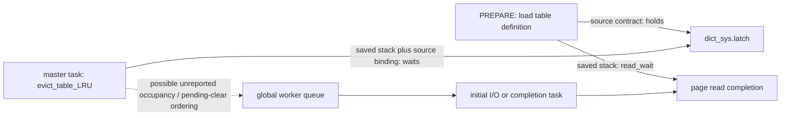

# Issue156: connect the controlled stall to saved PREPARE stacks

**A concrete unreported worker wait is present in the saved profiles:
master-task dictionary-cache eviction waits for `dict_sys.latch` without a local
tpool wait notification. The foreground PREPARE is loading a table definition
through code that holds that dictionary latch while waiting for page I/O.**
This is a source-inferred dependency consistent with all four saved captures,
not a runtime lock-owner trace or proof of the creation_pending interleaving.

Recommend a small experimental change confined to the contended dictionary-lock
acquisition in master eviction, with balanced wait notification. This is a more
specific next target than an unconditional `read_wait` change, global pool policy
change or another random reproduction campaign. Do not adopt it from this source
review alone. The strongest objection is material: neither pending/refusal order
nor the actual recovery event was captured in these PREPARE profiles; the purge
and loader paths already contain notifications that can provide progress.
One capture also has purge waiting on the dictionary shared latch without a local notification. A master-only change therefore cannot claim to cover every unreported worker wait. The original tail may have a different cause. Keep #140/#156 open.

## What changed in our understanding

The previous native 36/36 and generated-guest 18/18 controls prove that a worker
can clear creation_pending, enter an unreported wait, and leave queued work until
a later progress trigger. They do not identify the real task corresponding to A.
This source step narrows the relevant waits to dictionary contention (master in 4/4; purge also in 1/4) using existing profiles, with no new runtime
execution or benchmark.

| Saved stack role | C path and current generated correspondence | Wait reporting | Interpretation |
| --- | --- | --- | --- |
| Foreground PREPARE | `dict_table_open_on_name → dict_sys_t::load_table → dict_load_table_one → buf_page_get_gen → read_wait` (`Fn17739/17710/17711/18164/16787`) | `read_wait` calls tpool notification only for nonnull trx; notification itself requires pool TLS | Not the pool worker A in the two-task control. A missing foreground notification alone does not establish missing pool capacity. |
| Purge coordinator, 3 captures | `purge_coordinator_callback → do_purge → trx_purge → choose_next_log → page_fix → read_wait` (`Fn18228/17221/17217/18162/16787`) | Callback creates/attaches trx and passes it down; read_wait contains begin/end | Do not relabel this stack as the trx=null foreground wait. Effective WAITING/LONG bits were not captured. |
| Purge coordinator, 1 capture | `trx_purge_table_open → dict_sys.freeze` (`Fn17220 → Fn92`) | Shared dictionary-latch slow path has no local begin/end | A second concrete unreported dictionary wait, in diagnostic-2-candidate. Do not classify all purge stacks as read_wait. |
| Buffer-pool load | `buf_dump_load_func → buf_load → os_aio_wait_until_no_pending_reads(true)` (`Fn17499/17500/18276`) | Generated caller passes literal 1; callee notifies when its pre-lock pending-count sample is nonzero | There is a notification path. A parked stack alone does not establish it was taken. |
| Master task | timer task → `srv_master_callback → evict_table_LRU → dict_sys_t::lock_wait` (`Fn16602/18236/17744/17733`) | No begin/end on this lock-wait path | Concrete candidate for unreported worker A; same path occurs in all four saved profiles. |

Each capture has three pool-shaped stacks (purge in one of the two forms above, loader and master) containing task::execute/worker_main
(Fn16586/Fn16595), all parked at the untimed host AtomicWait branch. Foreground has
its separate connection-thread chain and no worker_main frame. Counts describe
one instant per capture, not a complete pool census, lifetime, or wait duration.

## Dependency and its limits

The dictionary path is now grounded, rather than inferred merely from matching
400ms timing:

- `dict_table_open_on_name` takes the exclusive dictionary lock on a cache miss,
  calls `load_table`, and releases the lock afterward. If its `dict_locked`
  argument is true, the caller already owns it. `dict_load_table_one` asserts
  dictionary ownership and reads the table's root page before returning; that
  read branch does not release the dictionary latch. `load_table` also constructs
  its mini-transaction from the current THD's transaction, which may be null.
- The master evicts idle dictionary entries. `evict_table_LRU` takes the exclusive
  dictionary lock **before** checking whether the cache has enough entries to
  need eviction. Thus a small test schema does not by itself eliminate this wait.
- The actual current generated lock slow path uses the dictionary latch address
 18662528 and the diagnostic strings for `dict_sys.latch`; both the foreground
  opening path and eviction access that same global. Absolute addresses are tied
  only to the recorded generated source, never a reusable hook without rebinding.
- `dict_sys_t::lock_wait` waits for the exclusive latch and reports very long
  semaphore waits, but does not notify tpool before parking. The generated master
  / eviction / lock_wait path likewise has no direct Fn16583/Fn16584 call.
- Simulated AIO submits its initial task to the shared pool, performs synchronous
  I/O, then re-submits the completion callback to that pool. Either stage needs
  worker progress; read completion releases the page waiter. This is why an
  unrelated background task can delay a foreground PREPARE.

In the two candidate captures, Fn17711 calls Fn18164 directly; the two baseline captures additionally contain Fn18010, whose entire C body is not newly mapped here. The table-opening ownership contract remains the basis for the dependency inference; no full call-tree or lock-owner proof is claimed.

The same-DB foreground/master stacks and lock ownership contracts support a
specific dependency interpretation. **No actual owner address/TID was recorded.**
Do not claim the source-derived owner relation was observed directly, that purge
and PREPARE awaited the same page, or that current profiles include the older
request 3's 389.421ms global-queue trace. Those are different sources/runs.

There is also a small qualification for the loader: pending_io_count is an
approximate, unlocked cache-pos sample. The later wait checks under the mutex.
A zero sample followed by a new read could reach a wait without taking the
notification branch. This is a source-permitted ordering, not an observed race
or a reason to open another sampling campaign now.

## Primary anchors and source identity

Pinned upstream source_commit:
`83e909fc2a0dbc394b4b683fb3fa2d7dcf26cc5e`.
Current product/generated source_commit:
`8df45792a927e440972266ee799d6f7223713e14` (adopted UCA main).
Saved profile record:
`e556c36570e1be023f8a9c8243381c6605079592`; baseline arm source:
`500020e7dc6d702ef059f0e73a4bab738103b774`; candidate guest origin:
`f43257225e1fd65c58ea8f5d7b220c3a509c203b`.
Old captures remain attached to their own source, not relabeled as new main runs.

- [Dictionary open, exclusive scope and eviction](https://github.com/MariaDB/server/blob/83e909fc2a0dbc394b4b683fb3fa2d7dcf26cc5e/storage/innobase/dict/dict0dict.cc#L944): lock_wait944–971, open1011–1083, eviction1307–1337.
- [Table definition/root-page load](https://github.com/MariaDB/server/blob/83e909fc2a0dbc394b4b683fb3fa2d7dcf26cc5e/storage/innobase/dict/dict0load.cc#L2319): ownership2330, page read2471, load wrapper2548–2567.
- [Master and purge callbacks](https://github.com/MariaDB/server/blob/83e909fc2a0dbc394b4b683fb3fa2d7dcf26cc5e/storage/innobase/srv/srv0srv.cc#L1247): master1247–1301, purge coordinator1506–1515.
- [Purge transaction forwarding](https://github.com/MariaDB/server/blob/83e909fc2a0dbc394b4b683fb3fa2d7dcf26cc5e/storage/innobase/trx/trx0purge.cc#L774): get_page774–790, choose_next_log856–918, trx_purge1454 onward.
- [Purge table-open shared dictionary latch](https://github.com/MariaDB/server/blob/83e909fc2a0dbc394b4b683fb3fa2d7dcf26cc5e/storage/innobase/trx/trx0purge.cc#L1185): shared lock1193, exclusive fallback1198.
- [Read wait](https://github.com/MariaDB/server/blob/83e909fc2a0dbc394b4b683fb3fa2d7dcf26cc5e/storage/innobase/buf/buf0rea.cc#L206): conditional notifications206–237.
- [Loader completion wait](https://github.com/MariaDB/server/blob/83e909fc2a0dbc394b4b683fb3fa2d7dcf26cc5e/storage/innobase/buf/buf0dump.cc#L662) and [conditional AIO wait](https://github.com/MariaDB/server/blob/83e909fc2a0dbc394b4b683fb3fa2d7dcf26cc5e/storage/innobase/os/os0file.cc#L3234).
- [Pool TLS notification](https://github.com/MariaDB/server/blob/83e909fc2a0dbc394b4b683fb3fa2d7dcf26cc5e/tpool/wait_notification.cc) and [two AIO submissions](https://github.com/MariaDB/server/blob/83e909fc2a0dbc394b4b683fb3fa2d7dcf26cc5e/tpool/aio_simulated.cc#L143).

`bindings.json` preserves all fetched file hashes, full generated function hashes,
decoded literal anchors and the four selected stack chains/profile hashes. These
are structural C/generated correspondences, not a recovered full symbol map or
runtime argument capture. 18/19 compared functions have matching non-numeric
source tokens; Fn17221 also renumbers four SIMD helpers. Its selected trx-forwarding
calls are checked directly; no wildcard equivalence or execution guard uses this
normalization.

The declared guest patches do not modify the dictionary/purge/read_wait/pool
source paths discussed here. The canonical buffer-load patch already uses normal
global concurrency; do not import the upstream read-thread clamp into the current
interpretation. The os0file portability hunk changes WASIX file locking, outside
the examined AIO wait/callback paths. These patch boundaries are recorded.

## Next bounded work and stopping point

One useful prototype now has a concrete location: notify waiting **only on the
contended exclusive-lock path of dictionary-cache eviction**, balancing end after
acquisition. Avoid wrapping the entire housekeeping task as WAITING or blindly
modifying every dictionary lock acquisition. Check caller/nested-wait contracts
before selecting the final C patch boundary. Include the purge shared-lock variant in that audit, or explicitly limit the first prototype to master eviction; do not imply a master-only remedy covers both. No product change is implemented or
adopted by this report.

Reuse the existing controlled generated-guest harness to exercise the actual
lock slow path and queue progress, with and without notification. Required
outcomes: same pending-refusal/clear order, B progress before maintenance only in
the notified arm, balanced waiting/worker/task state, unchanged lock exclusion,
and complete cleanup. Include uncontended and non-pool callers so the fix is
not validated solely by a synthetic futex. Estimated incremental scope: one local
overlay test build (previous cold build about 100s), a fixed small control set,
no C rebuild or full CI; stop on source/caller mismatch instead of expanding into
a general observer framework. This validates the proposed remedy, not natural
incidence. Product adoption and an ordinary-workload A/B remain later decisions.

For causal closure on the original PREPARE tail, the missing evidence is still:
master task identity at pending clear/refusal; the same read generation remaining
queued while workers cannot service it; and the first actual recovery trigger.
The source analysis narrows this target and disproves neither competing
explanations nor the earlier observer-off latency result. Simply eliminating a
400ms sample in a few runs is not the exit criterion.

## Verification and retention

Read-only `python3 docs/reviews/issue156-source-path/check.py` checks the pinned
Git profile/function objects, selected call arguments, decoded literals and this
package's checksums. It requires the cited Git history. Optional `--upstream DIR`
also checks the downloaded primary-source hashes. It does not reconstruct runtime
state or prove the report's causal interpretation mechanically.

The check is run with the fetched upstream sources and again without them before preservation.
No builds, guest runs, new timing samples or CI were executed in this step.
Owned downloaded sources and extracted generated bodies are recreatable and are
removed after preservation. Reports/compact bindings/replay are retained; no raw
CI logs, REST responses or full copied source tree enters the branch.
