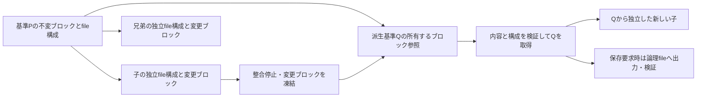

# Snapshotの受け渡しと所有：Eの整理／D独自形式の設計比較

2026-10-16。既存コード・実験結果による設計比較。新しい実装・計測は行っていない。

## Human Review

今決めたいのは、**次に具体化する設計を、Eの一時Snapshotの検査統合にするか、
D独自のブロックSnapshotにするか**です。推薦はEの検査統合を先に具体化すること。
普通の「準備を一度行い、独立した子でCRUDする」用途で既に利益が確認されたEに対し、
最終所有者の完全検証を残して、途中の重複検査を一つ減らす境界を限定できます。
今回その成立条件を整理しました。省略の安全性を実装で実証した段階ではありません。

最も強い反論は、Eの整理では子からの派生Snapshotの全量exportが残り、
Dの方が大きな処理削減につながり得ることです。その可能性は残します。
一方、前回のD＋Eは子I/Oだけの比較であり、D独自Snapshotの利益はまだ未測定です。
派生基準を頻繁に作る用途を優先するならDを先に選ぶ理由になります。
**二案とも候補として維持し、ここでは実装開始・採用・main統合を決めません。**

## 1. 守る価値と、変えてよい境界

根拠は[Product contract](../project-status.md#product-contract)と
[承認済みのSnapshot契約](../decisions/snapshot-product-contract.md)。
利用者はライブラリを呼び、実MariaDBを使い、各テストを独立して破棄できます。
通常のcommit/rollback、兄弟非干渉、基準Close後の開始済み子の継続を守ります。
ユーザー管理のサーバーや、rollbackによるテスト隔離への置換は提案しません。

内部の一時Snapshotを保存形式と分けることは可能です。
`snapshot()`、作成時に保存も行う`snapshot_to(path)`、外部の`load_snapshot(path)`は
区別します。後から`save()`を追加する契約変更は含みません。
Snapshot成功は元DBを消費し、transaction等の事前条件拒否は元DBを残します。

取得時にはinventory・内容・guest identityを完全検証し、検証した実体を所有します。
Forkごとの全量hash省略は、この所有取得を終えた後の話です。
「取得後の媒体破損を毎Forkで検知する契約ではない」ことを理由に、
取得前の破損検出を省きません。

## 2. 既存証拠から言えること

以下は別campaignの中央値です。横断して差を計算せず、各行の比較内で読みます。
いずれもmacOS arm64の小〜中規模、2子の限定結果です。

| 比較 | 利用者の待ち時間 | その他の結果 | 今回への意味 |
| --- | --- | --- | --- |
| 現行→E | 全体574.60→442.84 ms／1404.64→1266.76 ms | Snapshotで本体コピーを省略。内容走査は3回残る | 最初の基準作成で利益を確認 |
| E→C＋E | 全体444.0→497.9 ms／1279.3→1348.1 ms | 子ごと138〜159 MiBのfile copy、RSS増 | ファイル単位CoWを重ねる方向の優先度は低い |
| E→D＋E（子I/Oのみ） | 全体449.4→449.2 ms／1271.0→1291.8 ms | 子のGo累積割当約73%減、最大RSS減少なし | 子I/Oの速度利益は未確認。D独自Snapshotは未評価 |

出典：[E][e-report]、[C＋E][c-report]、[D＋E][d-report]。
Dの中規模全体差には変更していない準備側の差もあり、全部をDの悪化と帰属しません。
これらを大規模・多数子・並列・他OSでの利益や安全性の証明にはしません。

[pgmem調査](pgmem-vfs-design-review.md)のheap参照共有は同一プロセスの寿命が前提です。
Pythonから別Go hostを起動するmariamemでは、終了した準備hostのheap参照をそのまま
次のhostへ渡せません。共有できるbackingと所有者の設計が別途必要です。
[ブロック方式の調査](block-storage-design-discovery.md)が示したEOFと実体化量の分離は、
今回D＋Eの割当削減につながりましたが、全体高速化やSnapshot高速化とは別です。
古い調査のA〜F分類と今回のC/D/E記号は同じではありません。

## 3. 現在のE試作：本体をコピーせず、3回読む

Eは実験候補であり、mainの製品実装ではありません。
図の矢印は実体の移動・所有取得を表し、ファイル内容の複製ではありません。

停止後の[handoff][e-handoff]は元mappingから期待inventory/hashを作り、
mapping解除・論理size確定・writer FD Close・rename・同一inode確認を行います。
[publisher][e-publish]は移動先を全検査し、その後manifestを確定します。
[Python `_adopt`][py-owned]はreadonly FDを開き、pathを消し、保持するFDそのものを
全検査して元の期待hashと比較します。最後の検査には独立した同size破損oracleがあります。

同じinodeであることは、内容が変わっていない証明ではありません。
chmodでreadonlyにすることも、既存の書込FDやmappingの失効を証明しません。
実装が保持する全writerとworkerを閉じ、以降変更する経路をなくす必要があります。

## 4. 案E：一時Snapshotの最終所有取得へ検査をまとめる

### データの通り道

**狙いは3回の全内容走査を2回へ減らすことです。** 元の期待hash生成と、
最終所有者の内容検証は残します。途中に「公開済みの保存物」を作る必要のない
一時Snapshotだけで、publisherの検査と所有取得の検査を統合する案です。

一時pathを使う案では、Go hostは未取得の候補と期待manifestを私有stagingに置き、
内部的な「準備できた」通知を返します。公開APIのSnapshot成功は、Pythonまたは
Goの最終所有者が検証を終えた後です。未検証候補を既存の公開済み`manifest.json`
として扱いません。途中段階を読める公開Snapshotも作りません。

既存の`PublishSharedExperimental`から単にhashを削除する変更ではありません。
保存物を確定する経路と、一時候補を最終取得へ渡す経路を分けます。
`snapshot_to`の公開物検証と、外部importの独立copy＋検証は維持します。
Go APIにも同じ状態遷移を設けます。Pythonだけの高速化を共通契約の完成とはしません。

### 受け渡しHOWは二つ残す

| 手段 | 所有取得までの道筋 | 省けるもの／追加の仕事 |
| --- | --- | --- |
| E1 私有path経由 | source hostがstagingを作成→receiverがFD取得・unlink・検証 | 現試作に近い。途中の内容検査を統合できる可能性。部分移動・cleanupを整理 |
| E2 FD直接転送 | source hostがreadonly FD束と期待manifestをreceiverへ渡す→receiverが検証 | path経由の受け渡しを削減。子host→PythonへのFD転送protocolが新たに必要 |

現在のPython `pass_fds`はPython→子host方向です。逆向き転送が実装済みとは言いません。
E2でもwriterの停止・破棄と最終全内容検証は必要で、FDを渡せば検証不要にはなりません。
まずE1ならどこまで既存の所有処理を再利用できるかを具体化する推薦ですが、HOWの確定ではありません。

### 効果と限界

E試作の途中のinventory/hashは約66 msでした。これは削減対象区間の実測値であり、
新設計の全体短縮予測ではありません。読み込み・hash・inventoryが混在し、
処理順や寿命の変化で後段の時間も変わり得ます。
整合停止、元と最終所有者の走査、子のMariaDB起動は残ります。
MAP_PRIVATEの子から派生Snapshotを作る既存export/copyも、この案だけでは消えません。

## 5. 案D：一時Snapshotを不変ブロックの集合として所有する

前回D＋Eは子のread/write先を16 KiBブロックにしただけで、SnapshotはEのままでした。
ここで比較する案は、そのブロックを**次の基準へ引き継ぐ**別の設計です。

Snapshotはfile名・論理EOF・ブロック配置・holeと、読み取り専用backingを所有します。
子は独立metadataと変更分を持ちます。派生Qは未変更部分をPと共有し、変更部分だけを
凍結して所有できます。Pを閉じてもQと開始済み子が使えるよう、参照先のbackingの寿命を
それぞれが保持します。元世代に属するブロックを次世代の変更で上書きしません。

### プロセスを越える実体の候補

| 手段 | 利点の仮説 | 代償・残る処理 |
| --- | --- | --- |
| D1 変更分はheap、Snapshot時に変更分だけ共有backingへ配置 | 子I/O試作を出発点にでき、全fileの複製を避け得る | dirty部分のcopyと配置metadata生成は残る。heap参照を直接転送はできない |
| D2 最初から共有可能なarena内に変更ブロックを確保 | 停止時にブロック所有を渡し、dirty内容のcopyも避け得る | 書込可能なarenaと不変世代を分離する寿命・割当設計が必要。Fresh/CRUDへ費用が移る可能性 |

どちらもlibrary内部に閉じられ、ユーザー管理daemonは必須ではありません。
初回基準には準備したDB全体のbackingが必要です。また、前回D＋Eで観測した
約48 KiBの基準コピー量は子I/Oの値であり、派生Snapshotの転送量の予測ではありません。
同一hostへ複数guestを集約する別案ならheap共有の前提を変えられますが、
障害・終了の単位も変わるため、この二案の必須条件にはしません。

### 完全性を安くできると決めつけない

初回取得ではfile inventory・EOF・hole・block範囲・guest identityと内容を検証します。
blockのhashやroot IDがあるだけでは実体の完全性検証になりません。
今回の案では最終取得の全内容検証を残し、まずpayloadの全量複製を不要にする可能性を比較します。
派生取得で既に所有する未変更blockの検証を再利用するなら、正確な所有継承と不変性、
変更blockの元期待値との比較を別途示す必要があります。それを達成済みの速度利益には数えません。

`snapshot_to`では論理fileを既存保存形式へ出力して検証し、`load_snapshot`では独立取得します。
保存を高速化するとは限りません。共通blockを持つ長い世代列では、
少量の変更でも祖先backingを保持し続けることがあり、FD・metadata・回収の費用が増えます。
多数・深い派生の利益も費用も未測定です。

## 6. 所有・失敗時の対応を比較する

下表は**満たすべき設計条件**です。新案を試験してPASSした表ではありません。

| 境界／失敗 | Eの統合案 | D独自Snapshot案 |
| --- | --- | --- |
| transaction等で事前拒否 | 元DBとwriterを維持 | 同左。block世代を確定しない |
| 正常停止後、取得前 | stagingはhandoff責任者が管理。元DBは終了済み | 凍結候補と参照を管理。元DBは終了済み |
| 同size破損、欠落/余分file、異なるguest | 最終保持FDを元期待値と比較して拒否 | 内容・構成・参照先を元期待値と比較して拒否 |
| 途中失敗、受信側の取得失敗 | 有効Snapshotを返さず、候補・開いたFDを回収 | 有効Snapshotを返さず、新規block・候補参照だけ回収。既存親を壊さない |
| 基準CloseとForkが競合 | 受付と取得を同期。開始済み子は独自FD/mappingを保持 | 同じ受付規則＋参照blockの寿命を子が保持 |
| 子の更新、shrink/regrow | 現行CoW・zero規則を維持 | 変更blockだけ独立化。切詰め後の古い内容を再露出させない |
| 子から新基準を作り、親をClose | 派生Snapshotは既存copy経路 | 新基準が共有blockを独自に保持。祖先Closeで解放しない |
| 外部保存物の変更・削除 | importは独立copyを取得 | 同等の独立取得。外部pathを共有blockの実体として借り続けない |

現状の[Python `_snapshot`][py-api]はhost側失敗と取得側失敗を別の場所で処理します。
検査位置を移すと、同じ破損がHostErrorではなく取得側ValueErrorで現れる可能性があります。
元DBのclosed状態・公開エラーの扱い・cleanupを明示して揃える必要があり、
検査回数だけ変更して完成にはできません。

既存の[E失敗oracle][e-tests]と[Python境界試験][e-boundaries]は残します。
公開物の失敗時にmanifestを確定しないoracleを維持し、新しい一時経路でも
「取得前破損→エラー、使用可能なSnapshotなし、資源回収」を検証します。
途中hashを削ったので既存の破損注入を通過させる、期待hashを実際のhashで置換する、
あるいは受信側の全検証を無効化する方法は採用しません。

## 7. 同じ基準での比較と、次へ進む条件

| 基準 | Eの検査統合 | D独自Snapshot |
| --- | --- | --- |
| 主な利用者利益 | 最初の基準作成の待ちをさらに減らす可能性 | 子からの派生基準で全fileのexport/copyを避ける可能性 |
| 省く処理 | 一時Snapshot途中の全量検査1回 | 未変更payloadの再配置。方式次第でdirty payloadの再配置も |
| 残す処理 | 整合停止、元hash、最終検査、子の起動 | 同左。block化だけでhashや起動は消えない |
| 必要な変更範囲 | 一時handoff、Python/Go取得、エラー・寿命 | FS表現、block所有、host間protocol、世代寿命、保存/import変換 |
| 既存証拠 | Eの通常2子workflowで全体利益あり。検査統合そのものは未実装 | 子I/Oと割当削減は確認。新Snapshot経路の証拠はない |
| 失う単純さ | 内部preparedと取得済みの状態を区別 | 一基準一組のfileという構造から、共有blockの所有graphへ移る |
| 今回の位置づけ | 次に具体化する推薦候補 | 派生再利用を優先する場合の候補として維持 |

設計比較としては、二案の処理・所有・検証・失敗時対応・変更範囲の整理を完了しました。
いずれの実装成立・性能改善も今回新たに確認していません。
次のHuman判断後、選んだ境界だけの状態遷移と部品spikeを具体化できます。
その終了条件は、元期待値を保持した破損拒否、所有移転の途中失敗、
基準Close後の子・派生の独立性を示せること。示せなければ不足箇所を特定して止めます。
試作を採用する前には、全体workflowの利益と対象platformを別途確認します。

今回の推薦は「Dが効かない」からではなく、普通の一基準＋複数子に対するEの既存利益と、
追加で変える所有境界の小ささによります。派生基準の再利用を優先するというHuman判断なら、
D1/D2を先に具体化する選択と両立します。

## 記録と確認範囲

- baseline `source_commit`: `a8137b8b444f86068d3128a291e3a848adfdfd56`。
  `scripts/git_identity.py inspect HEAD`でcommit objectを確認。今回はbuildなし。
- E: `3ce25c29ebceb2bdfb6b430391f400ad3d8d90e0`。
- C＋E: `21a01a20d8f453fb626fd6fb724ec0ec1ba287f7`。
- D＋E: `c1875fa9e68d8588514cc1380d0ed3dc7d64409f`。
- 既存の[Go owned backing][go-owned]は取得後の継承FDを構造検査で受け取る。
  所有取得済み資源の再利用の先例であり、逆向きの作成handoffが完成済みという意味ではない。
- 今回は文書と参照先を確認し、diff/statusを検査。runtime・guest・生成物を変更せず、
  追加benchmark・runtime test・Qualificationは実施しない。
- mainの既存変更`docs/project-status.md`、未追跡の`storage-design-directions.md`と
  `storage-investment-reassessment.md`には触れない。承認前に製品方針を書き換えない。

[e-report]: https://github.com/masahitojp/mariamem/blob/3ce25c29ebceb2bdfb6b430391f400ad3d8d90e0/docs/reviews/e-snapshot-handoff.md
[c-report]: https://github.com/masahitojp/mariamem/blob/21a01a20d8f453fb626fd6fb724ec0ec1ba287f7/docs/reviews/ce-file-cow-spike.md
[d-report]: https://github.com/masahitojp/mariamem/blob/c1875fa9e68d8588514cc1380d0ed3dc7d64409f/docs/reviews/d-block-cow-spike.md
[e-handoff]: https://github.com/masahitojp/mariamem/blob/3ce25c29ebceb2bdfb6b430391f400ad3d8d90e0/benchmarks/spikes/e-handoff/handoff.go.txt
[e-publish]: https://github.com/masahitojp/mariamem/blob/3ce25c29ebceb2bdfb6b430391f400ad3d8d90e0/benchmarks/spikes/e-handoff/publish.go.txt
[e-tests]: https://github.com/masahitojp/mariamem/blob/3ce25c29ebceb2bdfb6b430391f400ad3d8d90e0/benchmarks/spikes/e-handoff/handoff_test.go.txt
[e-boundaries]: https://github.com/masahitojp/mariamem/blob/3ce25c29ebceb2bdfb6b430391f400ad3d8d90e0/benchmarks/spikes/e-handoff/boundaries.py
[py-owned]: https://github.com/masahitojp/mariamem/blob/a8137b8b444f86068d3128a291e3a848adfdfd56/python/mariamem/snapshot.py#L121
[py-api]: https://github.com/masahitojp/mariamem/blob/a8137b8b444f86068d3128a291e3a848adfdfd56/python/mariamem/__init__.py#L239
[go-owned]: https://github.com/masahitojp/mariamem/blob/a8137b8b444f86068d3128a291e3a848adfdfd56/internal/snapshot/owned.go
